<div align="center">

# HypervisionPLC SCADA

**Web-baseret SCADA/HMI til PLC'er — tegn anlægget, se det live, betjen det fra browseren.**
*Open-source web SCADA / HMI for PLCs on a Raspberry Pi.*

[](LICENSE)
[](CHANGELOG.md)


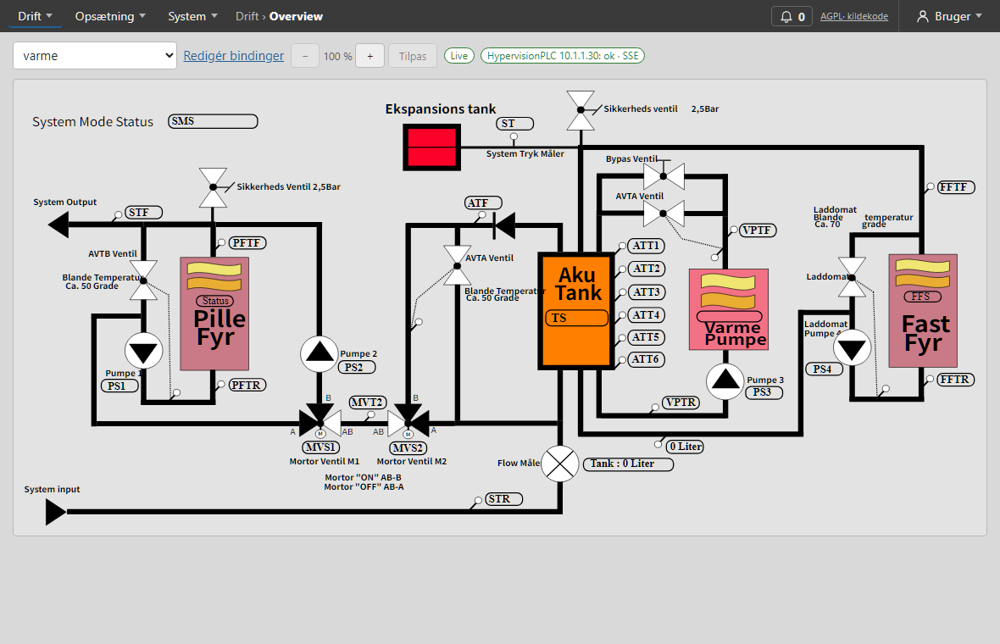

</div>

## Hvad kan den?

- 🖥️ **Overview** — anlæggets SVG-tegning med **live PLC-værdier**, animationer (farve, niveau, løbelys, tekst) og **betjening** af pumper, ventiler, omskiftere og setpunkter.
- ✏️ **Indbygget tegne-editor** — symbolbibliotek (proces, VVS, el, sol), **forbindelser** (rør og ledninger) der følger symbolerne, T-stykker, bøjningsradius, hjælpelinjer og fang.
- 🧩 **Symbol-guide i 6 trin** — tag, betjening, positioner, animationer, logikblokke, nøglelås og alarmer — uden at skrive kode.
- 🔔 **Alarmer** med prioritet, kvittering og historik · 📈 **Trends** med gemte visninger, middelkurver og dataanalyse · ⚡ **Energi** pr. dag/uge/måned · 🗓️ **Ugeprogrammer**.
- 🔌 **PLC'er og Modbus** — al kommunikation via PLC'ens REST API (+ SSE), også eksternt RS485-udstyr; kun SCADA-serveren taler med PLC'erne.
- 🔐 **Brugere og roller** (viewer, operatør, driftpanel, tekniker, admin) med adgang pr. tegning, audit-log, HTTPS, backup/restore og **OTA-opdatering** fra web-siden.
- 🍓 Kører på en **Raspberry Pi 4** som én systemd-service; frontend serveres statisk af FastAPI.

## In English

HypervisionPLC SCADA is an open-source, self-hosted **web SCADA / HMI** for PLCs, built for the **Raspberry Pi 4**. Upload or draw an **SVG process diagram**, bind its elements to PLC tags and watch the plant **live** in the browser — with operator controls, **alarm management**, **trends** (historian), energy reports, weekly schedules and **Modbus** (incl. RS485 devices) via the PLC's REST API. It includes a built-in **SVG drawing editor** with a symbol library, pipes/wires that follow the symbols, T-pieces and guide lines, and a no-code symbol wizard for animations and interlocks. Stack: Python 3.11, FastAPI, SQLite, Svelte 5, TypeScript. Licensed under **AGPL-3.0**. The UI and manual are in Danish.

## Dokumentation

- [docs/RESEARCH_OG_DESIGN.md](docs/RESEARCH_OG_DESIGN.md) — research, design og faseplan
- [ARCHITECTURE.md](ARCHITECTURE.md) — lag og projektstruktur
- [FEATURES.md](FEATURES.md) — backlog
- **Brugermanual:** i programmet under **Bruger › Manual** (kilden er markdown i [frontend/src/manual/](frontend/src/manual/)). Skærmbillederne tages automatisk fra en kørende server: `cd frontend && SCADA_URL=https://<server> SCADA_USER=<admin> SCADA_PASS=… npm run manual:screenshots` (kun læsning).
- [docs/SYMBOLSTANDARD.md](docs/SYMBOLSTANDARD.md) — designet for symboler (guide, kontaktplaner, animationer) + [interaktiv prototype](docs/prototyper/symbolguide.html)

## Skærmbilleder

Billederne er de samme som i brugermanualen ([frontend/public/manual/](frontend/public/manual/)).

**Tegn** — tegne-editoren med værktøjslinje, tegneflade og panelerne Valgt element, Egenskaber, Objekter og Symboler

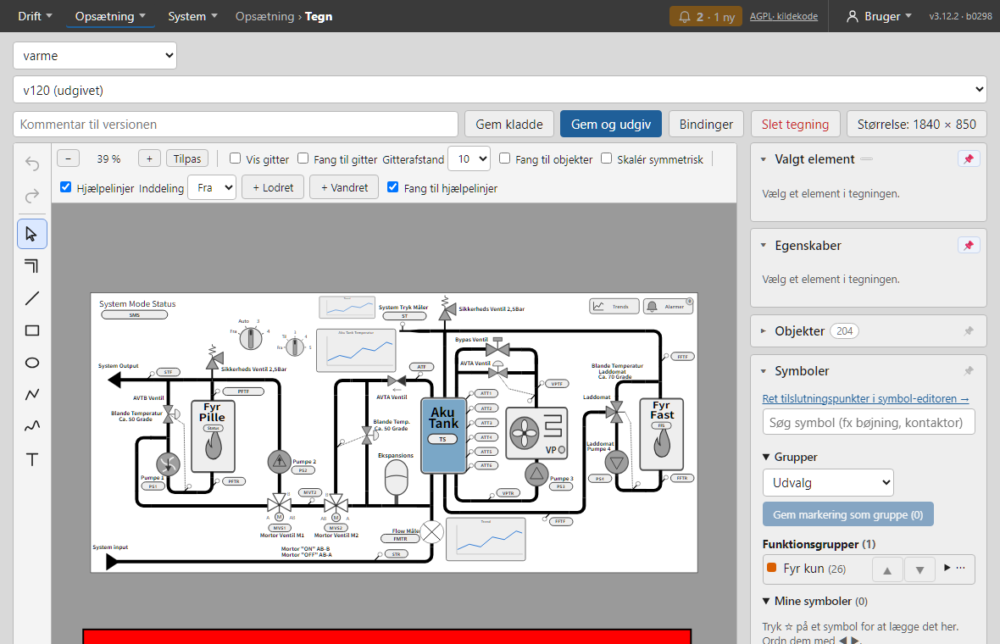

| Tegnehjælp og hjælpelinjer | Symbolbiblioteket |
|---|---|
| 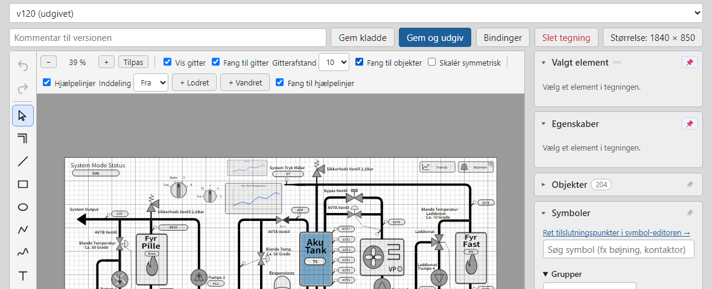 | 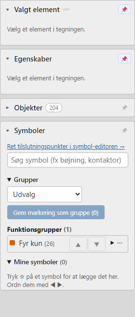 |

**Symbol-guiden** — sæt et symbol op i 6 trin: tag, betjening, positioner, animationer, nøglelås og alarmer

| Animationer (trin 4) | Logikblok |
|---|---|
| 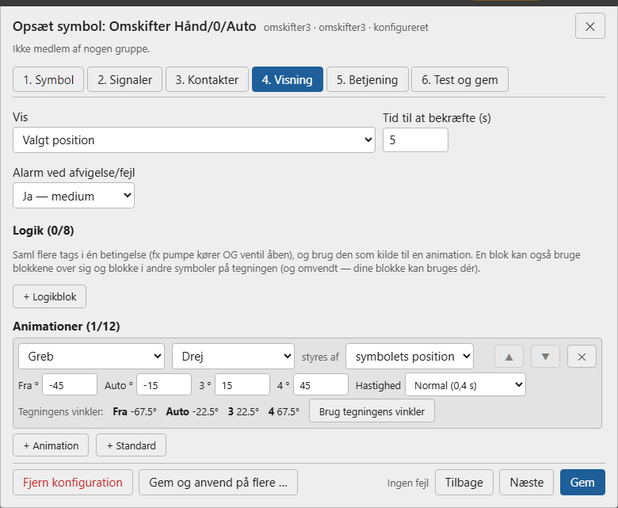 | 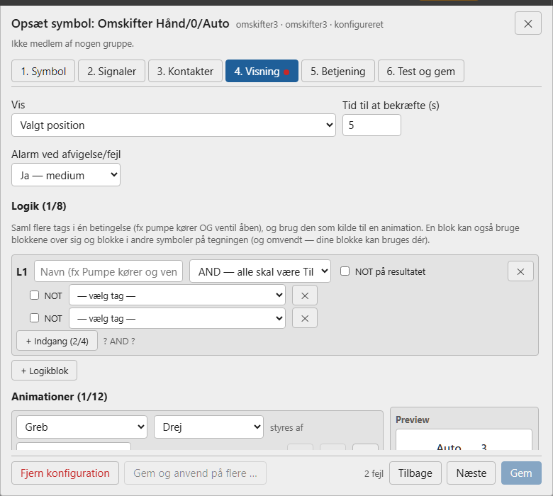 |

**Drift**

| Alarmer | Trends |
|---|---|
| 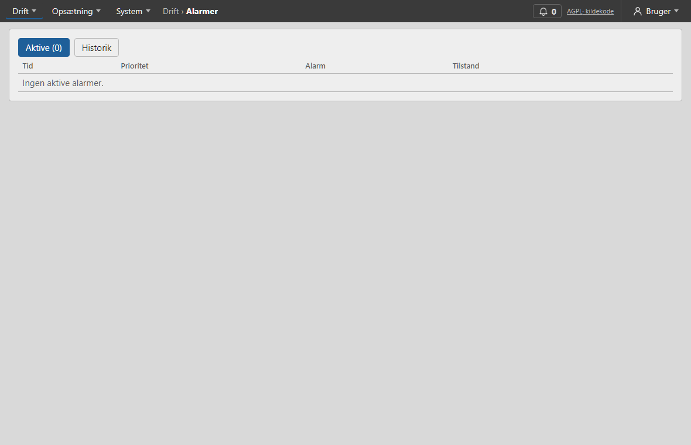 | 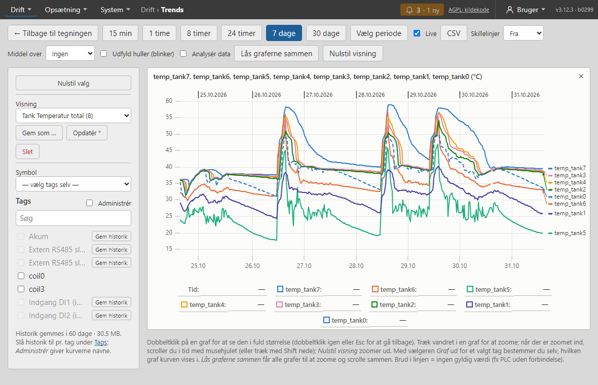 |

| Energi | Ugeprogrammer |
|---|---|
| 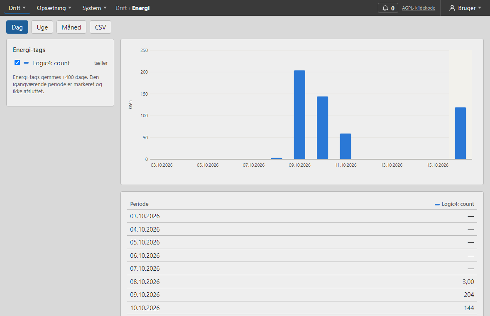 | 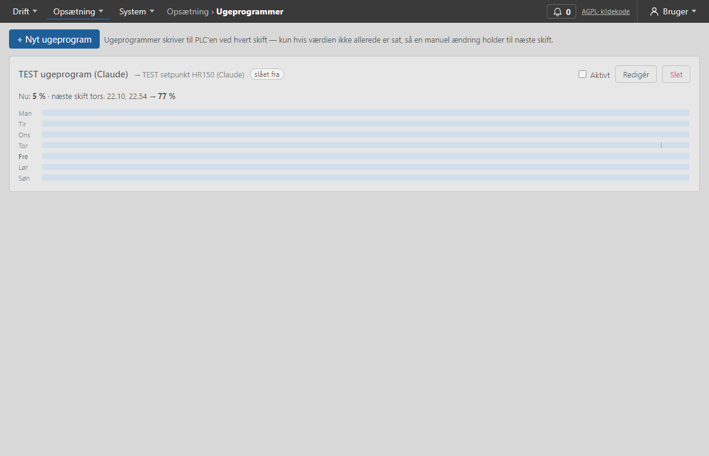 |

**Opsætning og system**

| Tags | Opdatering (OTA) |
|---|---|
| 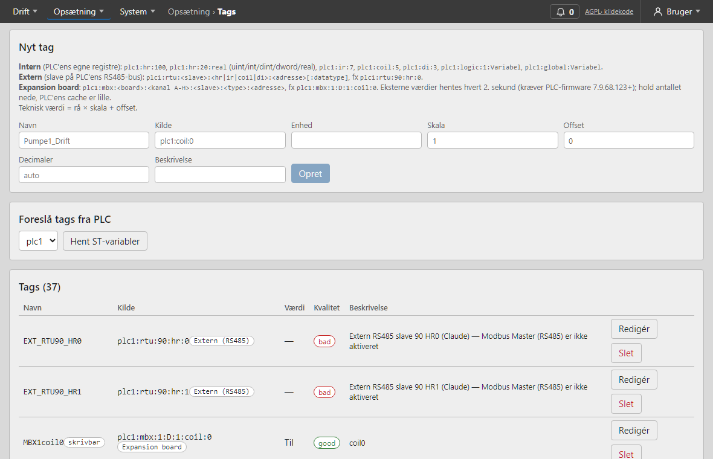 | 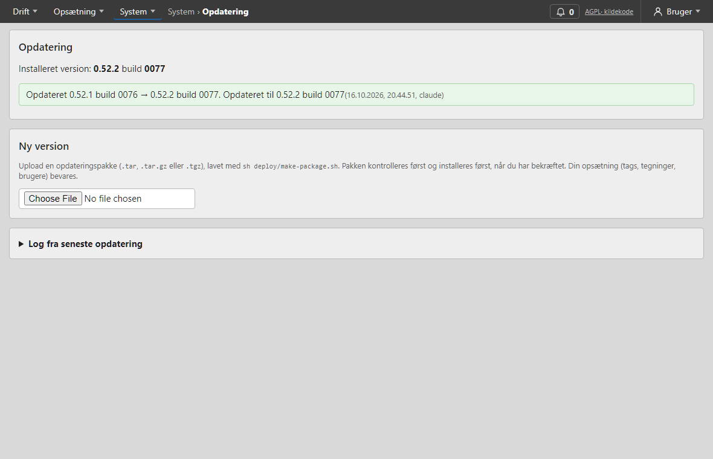 |

## Udvikling

```sh
cd backend
py -3.12 -m venv .venv && .venv/Scripts/python.exe -m pip install -r requirements-dev.txt
.venv/Scripts/python.exe -m pytest              # alle tests
.venv/Scripts/python.exe -m mock_plc --port 8081 # mock-PLC (login scada/scada123)
.venv/Scripts/python.exe -m app                  # SCADA-server på http://127.0.0.1:8000 (API-doc: /docs)
```

Frontend:

```sh
cd frontend
npm install
npm test            # vitest
npm run dev         # http://localhost:5173 (videresender /api og /ws til :8000)
npm run build       # → frontend/dist, som SCADA-serveren serverer (kopierer også SVG-Edit til public/svgedit/)
```

Eksempeltegninger: [docs/examples/](docs/examples/).

## Installation (Debian / Raspberry Pi OS)

### Ny Raspberry Pi direkte fra GitHub

Installér **Raspberry Pi OS Lite (64-bit)**, tilslut netværk og kør:

```sh
curl -fsSL https://raw.githubusercontent.com/Jangreenlarsen/HypervisionPLC-SCADA/main/deploy/bootstrap.sh | sudo sh
```

Scriptet henter den nyeste [Release](https://github.com/Jangreenlarsen/HypervisionPLC-SCADA/releases) (færdigbygget pakke — intet Node.js på Pi'en), kontrollerer kontrolsummen og kører `deploy/install.sh`. Til sidst vises adressen og engangsadgangskoden til `admin`. Valg sendes videre: `… | sudo sh -s -- --with-nginx scada.local 192.168.1.50` eller `--with-mock-plc`. En bestemt version: `… | sudo SCADA_VERSION=v3.13.0 sh`.

Releases bygges automatisk af GitHub Actions ([.github/workflows/release.yml](.github/workflows/release.yml)), når et tag `vX.Y.Z` pushes.

### Fra en udpakket kopi af repoet

```sh
sudo sh deploy/install.sh                 # SCADA som systemd-service
sudo sh deploy/install.sh --with-mock-plc # + mock-PLC til test
```
```sh
sudo sh deploy/install.sh --with-nginx scada.laces.dk 10.1.1.31   # + nginx med TLS (selvsigneret certifikat)
```
Konfiguration: `/etc/hypervisionplc-scada.env`. Data: `/var/lib/hypervisionplc-scada`. Certifikat: `/etc/hypervisionplc-scada/tls/`.

### Opdatering via web-siden (OTA)

Efter én installation med `deploy/install.sh` kan en admin opdatere serveren fra **System › Opdatering**:

1. Byg pakken på udviklingsmaskinen: `sh deploy/make-package.sh` → `scada-<version>-b<build>.tar`.
2. Upload den under System › Opdatering. Serveren kontrollerer pakken (sikre stier, version, nødvendige filer) og viser version og kontrolsum.
3. Tryk **Installér og genstart**. Der tages en backup, en lille root-tjeneste (`hypervisionplc-scada-update`) installerer pakken, genstarter og tjekker `/api/health`.
   Svarer den nye version ikke, **rulles der automatisk tilbage** til forrige kode. Status og log vises på siden og i `/var/lib/hypervisionplc-scada/updates/`.

Nedgradering understøttes ikke (databasen kan være opgraderet). Kontrolsummen beskytter mod beskadigelse — ikke mod en ondsindet admin, som via opdateringen i praksis kan køre kode som root.

### Opdatering af en server fra Windows

Deploy altid det der er committet — `git archive` giver LF-linjeskift uanset Windows-arbejdsmappen:

```sh
cd frontend && npm run build && cd ..
git archive --format=tar --prefix=scada/ HEAD > scada.tar
tar --force-local -rf scada.tar --transform 's,^,scada/,' frontend/dist
# kopiér scada.tar til serveren, pak ud og kør: sudo sh scada/deploy/install.sh [...]
```

## Licens

Copyright (C) 2026 Jan Green Larsen

HypervisionPLC SCADA er fri software: du kan videredistribuere og/eller ændre den under betingelserne i **GNU Affero General Public License v3.0 eller senere** (AGPL-3.0-or-later), som udgivet af Free Software Foundation. Se [LICENSE](LICENSE) for den fulde tekst.

Kører du en ændret version, som brugere tilgår over netværket (web-UI, REST API), kræver AGPL §13, at du tilbyder dem den tilsvarende kildekode. SCADA'ens web-UI viser derfor et link til kildekoden.

Tredjepartskomponenter beholder deres egne licenser, fx SVG-Edit (MIT), FastAPI (MIT), Svelte (MIT) og DOMPurify (Apache-2.0/MPL-2.0).
