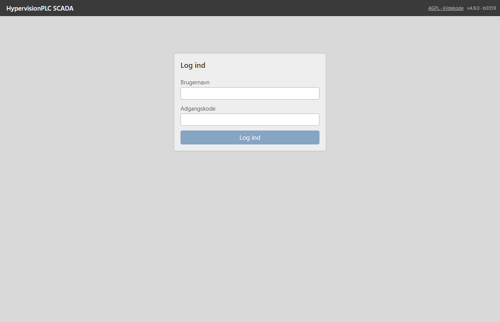
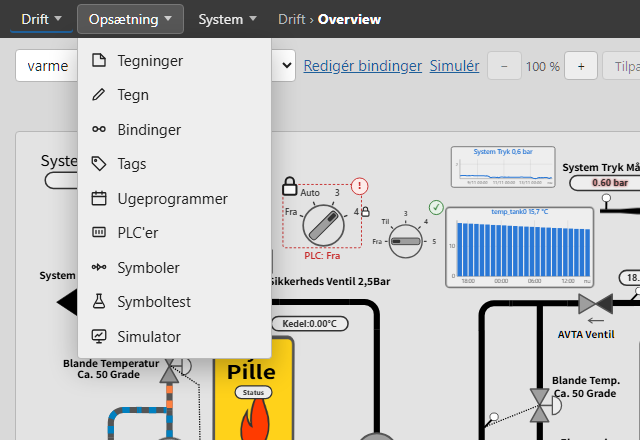
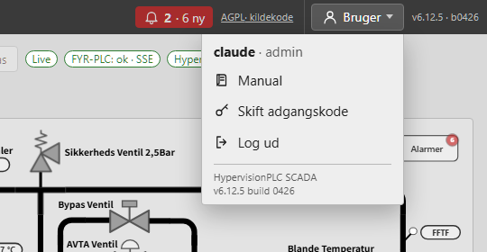

# Kom i gang

Velkommen til **HypervisionPLC SCADA** — en webside, hvor du ser og betjener anlægget live. Du behøver kun en browser. Alt hvad du ser og gør går gennem SCADA-serveren, som selv taler med PLC'en; din browser taler aldrig direkte med PLC'en.

## Sådan hænger systemet sammen

1. **PLC'er** er de styringer, SCADA'en henter data fra (se *PLC'er og tags*).
2. **Tags** er navngivne værdier fra PLC'en: en udgang, en indgang, et register, en temperatur …
3. **Tegninger** er SVG-billeder af anlægget (rør, tanke, pumper, ventiler). Du uploader dem, eller tegner dem i **Tegn**.
4. **Bindinger og animationer** knytter et element i tegningen til et tag: en pumpe bliver grøn, når tagget er Til; et tal vises som tekst; en tank fyldes efter niveauet.
5. **Symboler** fra biblioteket er færdige elementer (pumpe, ventil, omskifter, lampe …), som du sætter op med **guiden i 6 trin**.
6. **Overview** viser tegningen live. Her kan operatører også sende kommandoer og setpunkter tilbage til PLC'en.

> Tip: Start med at oprette en PLC og et par tags, upload eller tegn en tegning, og sæt et symbol op. Eksemplerne bagest i manualen følger præcis det forløb.

## Log ind

Skriv brugernavn og adgangskode. Er det første gang, eller har en administrator nulstillet din adgangskode, skal du vælge en ny (mindst 10 tegn), før du kommer videre. Du logges automatisk ud efter et stykke tids inaktivitet (standard 8 timer). Skift adgangskode eller log ud under **Bruger**.

## Menuen

Øverst står fire menupunkter. **Klik** på et punkt, så folder menuen sig ud over siden — vælg derefter siden. Et nyt klik på punktet, **Escape** eller et klik udenfor lukker menuen igen.

| Punkt | Indhold | Hvem |
| --- | --- | --- |
| **Drift** | Overview, Alarmer, Trends, Energi | alle |
| **Opsætning** | Tegninger, Tegn, Bindinger, Tags, Ugeprogrammer, PLC'er, Symboler, Symboltest | se *Roller* |
| **System** | Status, Log, Brugere, Backup, Opdatering, Notifikationer, Integrationer, Certifikater, Konfiguration, Hjælper (LLM) | tekniker (Status, Log) og admin |
| **Bruger** | Dit navn og din rolle, Skift adgangskode, Log ud, Manual, version | alle |

**Samme tegning på tværs af siderne:** Overview, Tegn, Bindinger og Simulator åbner den tegning, du står på. Kommer du fra en anden side (fx Tags), åbner de den tegning, du sidst havde åben i browserfanen.

Ud for menuerne står hvor du er (**Drift › Overview**). Til højre står knappen **Hjælper** (når hjælperen er slået til), en **alarmklokke** med antal aktive alarmer og linket **AGPL · kildekode**. Klokken blinker, når der er alarmer, du endnu ikke har kvitteret. Linket peger på programmets kildekode (programmet er fri software under AGPL-3.0). Yderst til højre står den installerede **version**, fx *v4.9.0 · b0359* — oplys den, hvis du melder en fejl.

## Roller

| Rolle | Kan | Kan ikke |
| --- | --- | --- |
| **Viewer** | Se Overview, alarmer, de trends der er sat op i tegningerne, og energi på de tegninger, der er givet adgang til | Betjene noget, vælge tags frit i Trends |
| **Operatør** | Alt viewer kan, samt betjene det, der er sat op til betjening (skifte positioner, trykknapper, indtaste setpunkter) og kvittere alarmer | Ændre opsætning, vælge tags frit i Trends |
| **Driftpanel** | Drifttegningen i fuld skærm uden menu — til en skærm i produktionen. Kan betjene og via genvejsknapperne i tegningen åbne **Alarmer** (kvittere) og **Trends** (kun de trends, der er sat op i tegningen) | Alt andet |
| **Tekniker** | Alt operatøren kan, samt vælge alle tags i Trends og Tegninger, Tegn, Bindinger, Tags, Ugeprogrammer, PLC'er, Symboltest og Log | Brugere, Backup, Opdatering |
| **Admin** | Alt, også Brugere, Backup og Opdatering | — |

En administrator kan begrænse viewer, operatør og driftpanel til udvalgte tegninger (se *System*). Reglerne håndhæves af serveren — de er ikke bare skjult i menuen.

## Betjening er altid kontrolleret

Alt der skrives til PLC'en er sikret flere gange: serveren tjekker din rolle, at tagget må skrives, og at værdien er gyldig. Efter en skrivning læser serveren værdien tilbage og viser resultatet. Alle skrivninger står i **Log**, med hvem, hvad og hvornår. Symboler kan desuden kræve en bekræftelse eller en firecifret **kode** (nøglelås) før en bestemt handling.

## Hjælp i programmet

Der er tre steder at få hjælp:

- **Manualen** — under **Bruger › Manual**. Kapitlerne står i venstre side, grupperet efter emne. Søg med feltet øverst; træffene vises med kapitel og afsnit, og et klik åbner afsnittet med søgeordet fremhævet. Klik på et skærmbillede for at se det stort.
- **Hjælperen** — knappen **Hjælper** i topbjælken (når den er slået til). Spørg med dine egne ord, fx *"Hvordan kvitterer jeg en alarm?"*. Den svarer ud fra manualen og det, du har adgang til, og viser de afsnit, svaret bygger på. Se *Drift › Hjælperen*.
- **Tooltips** — peg på et symbol på Overview for at se en kort **forklaring**, hvis teknikeren har skrevet en. Mange knapper viser også en forklaring, når du peger på dem.
