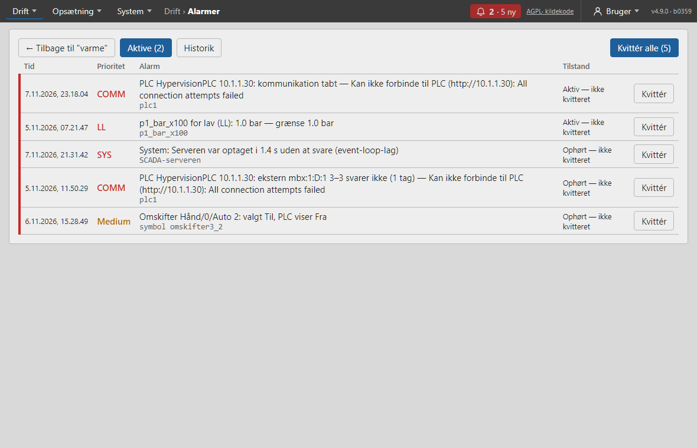
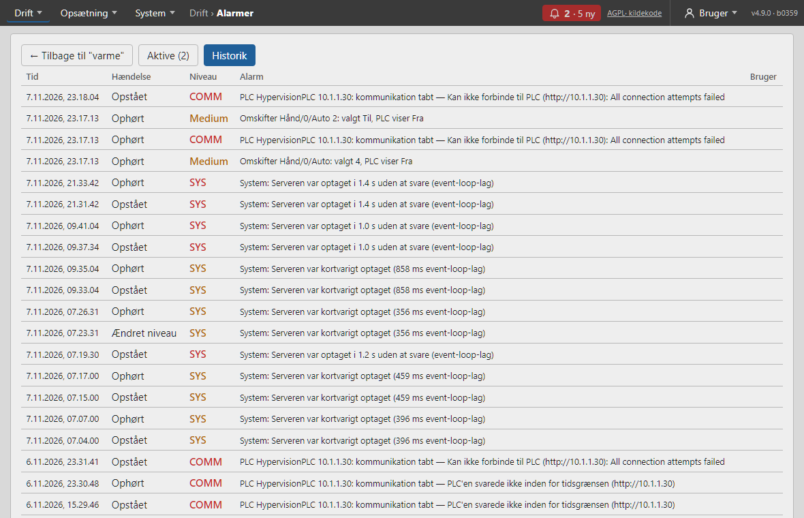

# Alarmer

Alarmklokken i topbjælken åbner siden **Alarmer**. Et **driftpanel** (uden topbjælke) åbner den med knappen *Gå til Alarmer* i tegningen og kan kvittere derfra.

## Aktive alarmer

Fanen **Aktive** viser de alarmer, der er i gang lige nu, og dem der er ophørt, men endnu ikke kvitteret. Tallet på fanen, *Aktive (3)*, er antallet. Listen opdateres af sig selv — du skal ikke genindlæse siden.

| Kolonne | Hvad den viser |
| --- | --- |
| **Tid** | Hvornår alarmen opstod |
| **Prioritet** | Grænsen (*LL*, *L*, *H*, *HH*), *SYS* for serveren selv, eller prioriteten (*Høj*, *Medium*, *Lav*) for et symbols afvigelse |
| **Alarm** | Alarmteksten og under den tagget, PLC'en, symbolet eller *SCADA-serveren* |
| **Tilstand** | *Aktiv — ikke kvitteret*, *Aktiv — kvitteret* (med hvem og hvornår) eller *Ophørt — ikke kvitteret* |

En alarm, der ikke er kvitteret, har en **rød streg** i venstre side af rækken. Ude til højre står **Kvittér** og (når hjælperen er slået til) **Forklar**.

## Kvittér en alarm

Tryk **Kvittér** på en alarm for at sige, at du har set den, eller **Kvittér alle (N)** øverst til højre for alle ukvitterede på én gang. Kvittering kræver rollen **operatør** (eller højere); en bruger med rollen *viewer* ser teksten *Kvittering kræver rollen operatør*.

Hvad sker der bagefter?

1. En kvitteret alarm er **stadig aktiv**, indtil årsagen er væk. Den står med *Aktiv — kvitteret* og navnet på den, der kvitterede.
2. Når årsagen er væk, ophører alarmen og forsvinder fra *Aktive*. Den står derefter i *Historik*.
3. Ophører en alarm, **før** den er kvitteret, bliver den stående som *Ophørt — ikke kvitteret*, til nogen kvitterer — så ingen alarm går ubemærket hen.

Alarmklokken holder op med at blinke, når alle alarmer er kvitteret. Alle kvitteringer gemmes med bruger og tidspunkt (se *Historik* og *System › Log*).

## Forklar en alarm

Er hjælperen slået til, har hver alarm knappen **Forklar**. Hjælperen får alarmen, tagget med dets aktuelle værdi og trenden for den seneste time samt de relevante afsnit af manualen. Den svarer i panelet til højre med, hvad alarmen betyder, og hvad du kan tjekke. Se *Drift › Hjælperen*.

- Svaret er et **forslag**. Hjælperen kvitterer ikke, skriver ikke til PLC'en og ændrer ingen indstillinger.
- Under svaret står **kilderne** (fx *Manual › Alarmer › Hvor kommer alarmer fra?*). Klik på en kilde for at læse afsnittet.
- Hjælperen kører på serveren selv (en lokal sprogmodel), så et svar kan tage 1–2 minutter. Imens kan du bruge SCADA'en som normalt.
- Ser du ikke **Forklar**, er hjælperen slået fra under *System › Hjælper (LLM)*, eller din rolle må ikke spørge.

## Opsummér døgnet

Er hjælperen slået til, står knappen **Opsummér døgnet** ved fanerne. Den åbner hjælperen med en opsummering af alarmerne fra de seneste 24 timer: hvad der skete, hvad der gentog sig, og hvad der bør undersøges.

Tallene beregnes af SCADA'en selv ud fra alarmhistorikken — hvor mange gange hver alarm kom, hvor længe den var aktiv, hvor hurtigt den blev kvitteret, og hvad der stadig er aktivt — og hjælperen skriver dem sammen til en kort tekst. De hyppigste 12 alarmer kommer med. Du ser kun de alarmer, du selv har adgang til. Spørg videre i panelet, fx *"Hvorfor kommer trykalarmen så tit?"*.

## Historik

Fanen **Historik** viser de seneste 500 hændelser, nyeste øverst. Hver række er én hændelse:

- **Opstået** — alarmen kom.
- **Kvitteret** — med navnet på brugeren i kolonnen *Bruger*.
- **Ophørt** — årsagen forsvandt.
- **Ændret niveau** — en grænsealarm gik fx fra *H* til *HH*.

Brug historikken til at se, hvor ofte en alarm kommer, og hvor lang tid der går, før den bliver kvitteret. Vil du se værdien omkring tidspunktet, så åbn tagget i **Trends** (kræver at tagget gemmer historik).

## Prioritet og alarmklokken

Alarmer har en **prioritet**: *lav*, *medium* eller *høj*. For et tag følger den niveauet: **HH** og **LL** er *høj*, **H** og **L** er *medium*, og en til/fra-alarm er *høj*. For et symbols afvigelsesalarm vælges den i guidens trin 4 (*Alarm ved afvigelse/fejl*).

**Alarmklokken** i topbjælken viser antallet af aktive alarmer og hvor mange der er nye (ukvitterede), fx *3 · 3 ny*:

- **rød** — mindst én aktiv alarm har høj prioritet;
- **orange** — den højeste er medium;
- **blinker** — mindst én alarm er ikke kvitteret.

Klik på klokken for at åbne *Alarmer*.

## Alarmer om serveren selv (SYS)

Ud over tag-alarmer og kommunikationsalarmer laver SCADA en alarm, når noget er galt med **serveren eller maskinen**: disk næsten fuld, serveren optaget (event-loop-lag), langsom database, lidt hukommelse, varm CPU, **lav spænding fra strømforsyningen**, gammel backup eller et certifikat, der snart udløber. De vises med niveauet **SYS** og teksten *System: …*, kan kvitteres som andre alarmer og står i historikken. En advarsel skal ses to gange i træk (ca. et minut), før den bliver en alarm; en alvorlig fejl udløser straks. Alarmen ophører først to minutter efter, at problemet er væk. Kun problemer, der kræver handling, giver alarm: at strømforsyningen *har været* for svag siden start står kun på Status-siden. Brugere, der er begrænset til udvalgte tegninger, ser ikke SYS-alarmer (de hører ikke til nogen tegning); teknikere og administratorer ser dem. Kan slås fra med `SCADA_HEALTH_ALARMS=0`.

## Hvor kommer alarmer fra?

- **Grænsealarmer** på tal-tags: *LL* (lav-lav), *L* (lav), *H* (høj) og *HH* (høj-høj), med **dødbånd** (så alarmen ikke svinger ved grænsen) og **forsinkelse** (værdien skal have været uden for grænsen så længe, før alarmen kommer).
- **Til/fra-alarm** på et til/fra-tag: alarm når tagget er Til (eller Fra).
- **Kommunikationsalarm**: en PLC har ikke svaret i en periode.
- **Symbolafvigelse**: et symbol, hvor den valgte position ikke svarer til PLC'ens position (vælges i guiden, trin 4).

## Opsæt alarmer

Alarmgrænser opsættes pr. tag under **Tags → Redigér → Alarmer** (se *PLC'er og tags › Alarmer på et tag*) — eller i symbolguidens **trin 6** (*Ret alarm* ud for tagget) for symbolets tags. Her sættes også **dødbånd** og **forsinkelse**; prioriteten følger niveauet.

Sådan sætter du en alarm for høj temperatur:

1. Åbn **Tags** og tryk **Redigér** ud for temperatur-tagget.
2. Skriv grænsen i **H**, fx 80 (giver en alarm med prioritet medium). Skriv evt. 90 i **HH** (prioritet høj).
3. Sæt **dødbånd** (fx 2), så alarmen først ophører under 78 — ellers kommer og går den, når værdien ligger lige ved grænsen.
4. Sæt **forsinkelse** (fx 10 s), så korte spidser ikke giver alarm.
5. Tryk **Gem**. Alarmen virker med det samme.

Eksempel: se *Alarm ved høj temperatur — og kurve* i *Eksempler trin for trin*.

## Alarmer i tegningen

De dele af et symbol, der **viser værdien** af et tag i alarm (*Værdi* og *Niveau*), får en rød markering på Overview — den **blinker**, til alarmen er kvitteret, og **lyser fast**, til den er ophørt. Dele, der blot bruger tagget til fx farve, markeres ikke.

Et symbol kan også selv vise alarmen (fx blinke ved en ukvitteret alarm) — se *Symboler og guiden*. Knappen **Gå til Alarmer** i tegningen viser antallet af aktive alarmer (se *Tegn › Symbolbiblioteket*).

> Øverst på **Alarmer**, **Trends** og **Energi** står knappen **← Tilbage til "…"**, der fører tilbage til den tegning, du sidst så i Overview (fx efter et klik på en genvej i tegningen).
