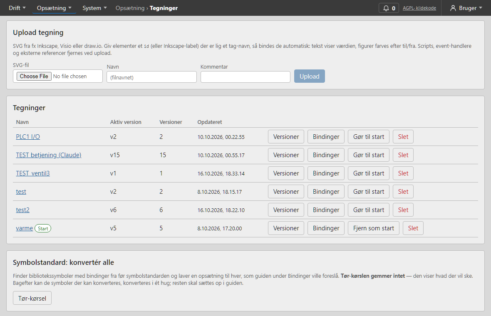
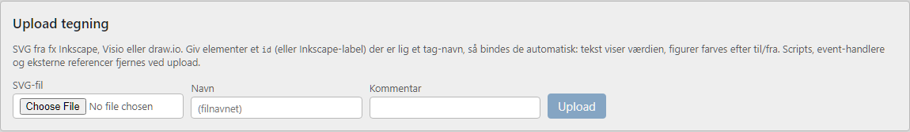
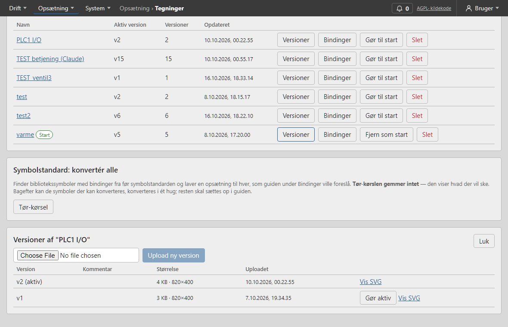

# Tegninger

En **tegning** er et SVG-billede af anlægget. Du kan **uploade** en tegning lavet i et andet program (fx Inkscape) eller **tegne** den i systemets egen editor (kapitlet *Tegn*). Begge dele ligger under **Opsætning** og kræver rollen tekniker.

Siden **Tegninger** er listen over alle tegninger.

## Upload en tegning

Tryk **Upload tegning**, vælg en SVG-fil (højst 5 MB), og giv den et **navn** og evt. en **kommentar**. Serveren renser filen (scripts og andet farligt fjernes) og viser en rapport over, hvad der blev fjernet.

## Versioner

Hver gang du uploader eller gemmer, opstår en ny **version**. **Versioner** viser listen; **Gør aktiv** vælger, hvilken version Overview viser. Du kan derfor forberede en ny version uden at brugerne ser den, og gå tilbage, hvis noget går galt. **Upload ny version** lægger en ny version til en eksisterende tegning.

> Bindinger følger tegningens **element-id'er**. Ændrer en ny version et elements id, mister det sin binding; **Bindinger** viser *Forsvundne elementer*, som du kan rydde op i.

## Start-tegning

**Gør start-tegning**: Overview åbner med denne tegning. **Fjern** start-tegningen, og Overview åbner med den første i listen.

## Deaktivér en tegning

**Deaktivér / Aktivér** gør tegningen **offline** — den vises grå på Overview med beskeden *Tegningen er deaktiveret*, uden live-værdier og uden betjening (heller ikke fra panelet), og symbolernes positions-overvågning og afvigelsesalarmer stopper. Tags, som **kun** deaktiverede tegninger bruger, holder op med at blive pollet (mindre trafik til PLC'en). Tags med **alarm, trend, energi eller ugeprogram** pollas stadig — alarmer slås aldrig fra, fordi en tegning er skjult. Tegning, versioner og opsætning bevares; **Aktivér** henter den online igen. Kun teknikere og admin kan deaktivere.

## Slet en tegning

**Slet** sletter tegningen med alle versioner og bindinger. Før du bekræfter, viser systemet **hvad det rammer**: antal versioner og bindinger, andre tegninger med en "gå til"-knap hertil (de holder op med at virke), om det er start-tegningen, og hvilke brugere der har adgang til den.
