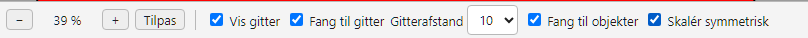
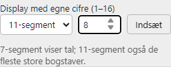
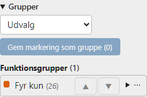
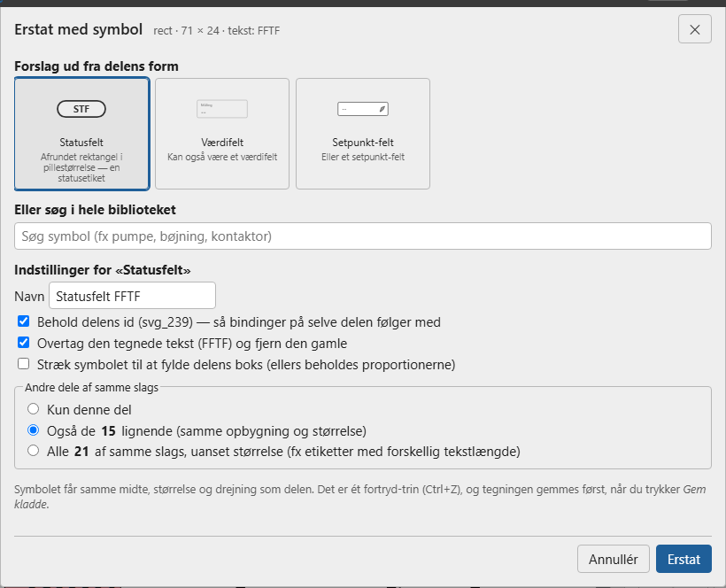

# Tegn – tegne-editoren

**Tegn** (under **Opsætning**, rollen tekniker) er den indbyggede tegne-editor. Brug den til at tegne anlægget, indsætte færdige **symboler** fra biblioteket og forbinde dem med **forbindelser** (rør og ledninger — se næste kapitel).

## Skærmen

- **Øverst**: vælg tegning og version, **Gem kladde**, **Gem og udgiv**, **Bindinger**, **Slet tegning** og **Størrelse**.
- **Linjen over tegnefladen**: zoom (−, +, **Tilpas**), **tegnehjælp** (gitter og fang) og **hjælpelinjer**.
- **Værktøjslinjen til venstre**: **Fortryd** og **Gentag** øverst, derefter værktøjerne **Vælg** (V), **Forbindelse** (O), **Linje** (L), **Rektangel** (R), **Ellipse** (E), **Sti** (P), **Frihånd** (F) og **Tekst** (T). Bogstavet er genvejstasten.
- **Tegnefladen** i midten. **Ctrl + musehjul** zoomer, og **mellemrum** eller **midterknappen** + træk flytter udsnittet.
- **Linjen i bunden** forklarer, hvordan det valgte værktøj bruges (fx *Rektangel: træk for at tegne · Shift = kvadrat · Esc = tilbage til Vælg*).
- **Panelet til højre** med foldbare sektioner (se *Panelet til højre*).

## Sådan tegner du

1. Vælg en eksisterende tegning (og version) i rullelisterne øverst, eller start en ny (**— Ny tegning —**). Står du på en tegning i **Overview**, åbner menupunktet **Tegn** (og **Bindinger**) direkte den tegning.
2. Tegn med værktøjerne til venstre, og indsæt symboler fra **Symboler** til højre — klik på et symbol, eller **træk det ind** på tegningen, hvor det skal stå.
3. Under **Valgt element** giver du elementet et **Navn**, hvis det skal være et symbol, der kan sættes op med guiden. **Avanceret** viser elementets tekniske **id**.
4. Tryk **Gem kladde** (gemmer en ny version, men viser den ikke endnu) eller **Gem og udgiv** (gemmer og gør den aktiv). En ny tegning skal have et navn.
5. **Slet tegning** fjerner hele tegningen (med samme oversigt over, hvad det rammer, som på siden *Tegninger*). **Bindinger** åbner bindingsiden for tegningen.

Er der ændringer, du ikke har gemt, spørger systemet, før de kasseres.

## Vælg, flyt og markér

- **Klik** vælger et element; **Shift+klik** eller en **ramme** vælger flere. Træk for at flytte, træk i et hjørne for at ændre størrelsen, og træk i den grønne prik for at dreje.
- **Symboler oven i hinanden:** hold **Alt** nede og klik — så vælges elementet, der ligger *bagved* det valgte på samme sted; klik igen med Alt for at gå et lag længere ned. Du kan også vælge elementet i **Objekter**.
- **Knaplinjen over det markerede**: justér (venstre, midte, højre, top, midte, bund), fordel vandret/lodret (mindst 3), læg øverst/nederst, spejl, **Gruppér**/**Opløs**, **Dupliker** og **Slet**.
- **Højreklik** giver klip, kopiér, indsæt, dupliker, gruppér, rækkefølge og slet.

## Taster

Alt kan fortrydes med **Ctrl+Z** (**Ctrl+Y** gentager). **Delete** sletter, **Ctrl+C/X/V** kopierer/klipper/indsætter, **Ctrl+D** duplikerer, **Ctrl+G** grupperer (**Ctrl+Shift+G** opløser), **Ctrl+A** vælger alt, piletasterne flytter 1 (med **Shift** 10), **Ctrl+0** tilpasser zoom, og **Esc** går tilbage til Vælg. Tasterne virker ikke, mens du skriver i et felt — klik i tegningen først.

## Panelet til højre

Panelet består af foldbare sektioner. Klik på en overskrift for at folde den ud — de andre foldes så sammen, undtagen dem du har **fastgjort med 📌** (de står altid åbne; valget huskes i browseren). Fra start er *Valgt element* og *Egenskaber* fastgjort.

- **Valgt element**: navn, **Opsæt symbol (6 trin)**, **Kopiér opsætning**, **Erstat med symbol …**, **Ret tilslutningspunkter …** og **Farver**.
- **Egenskaber**: placering (X/Y), størrelse (B/H), drejning, hjørner, fyld, streg, tykkelse og synlighed — skriv en værdi og tryk **Enter**. For tekster og forbindelser er der flere felter (se *Tekst* og kapitlet *Forbindelser*).
- **Objekter**: alle elementer i tegningen, forrest øverst. Klik vælger (også et element, der ligger skjult under et andet), **Ctrl-klik** vælger flere, og **▲▼** flytter det valgte frem eller tilbage.
- **Symboler**: symbolbiblioteket og grupper (se *Symbolbiblioteket* og *Grupper af symboler*).

## Tekst

Vælg værktøjet **Tekst** (T), klik og skriv; dobbeltklik på en tekst for at rette den direkte. Når en tekst er valgt, har *Egenskaber* en tekst-del:

- **Tekst** — ret teksten i feltet; **Enter** giver en ny linje (teksten står så på flere linjer). Klik uden for feltet for at gemme.
- **Størrelse** (skriv eller vælg fra listen) og **Skrifttype**.
- **F**, **K**, **U** — fed, kursiv og understreget (klik igen for at slå fra).
- **Justering** — venstre-, centreret eller højrestillet; teksten bliver stående samme sted.
- **Farve** — tekstens farve.

## Tegningens størrelse

Knappen **Størrelse: 1200 × 700** øverst viser og ændrer tegningens bredde og højde. Vælg et **fast valg** (fx *Full HD-skærm 1920 × 1080* eller *Panel 1280 × 800*) eller skriv bredde og højde (100–10000), og tryk **Brug størrelsen**. **Tilpas til indholdet** flytter tegningen op i hjørnet og gør den præcis stor nok med den valgte margen. En baggrund, der fyldte hele tegningen, følger med. Nye tegninger starter på 1200 × 700, og Overview skalerer altid tegningen til skærmen.

## Tegnehjælp: gitter, fang og drejning

Linjen over tegnefladen har **tegnehjælpen**:

- **Vis gitter** viser et net **ovenpå** tegningen (det ændrer ikke tegningen). Linjerne ligger med den valgte **gitterafstand** (5, 10, 20, 25 eller 50 enheder), og hver 5. linje er kraftigere.
- **Fang til gitter** lægger objekter på gitteret: når du flytter, indsætter eller duplikerer, flyttes objektets **øverste venstre hjørne** til nærmeste gitterpunkt.
- **Fang til objekter**: slipper du et objekt tæt på et andet, lægger det sig **kant mod kant** eller **midte mod midte** med det nærmeste. Små justeringer med piletasterne fanges ikke.
- **Skalér symmetrisk**: trækker du i et hjørne, ændres bredde og højde i samme forhold. Hold **Shift** nede for at skalere frit (uden indstillingen er det omvendt).
- **Drejning** sker i **15°-trin**. Hold **Shift** nede, mens du drejer, for at dreje **frit**.

Indstillingerne huskes i din browser.

## Hjælpelinjer

Hjælpelinjer er linjer, du bygger tegningen op efter. De **gemmes i tegningen** (så alle, der redigerer den, ser dem), men vises **kun i Tegn** — aldrig i Overview eller drift.

- **Hjælpelinjer** viser/skjuler dem (sletter dem ikke).
- **Inddeling** (Fra/50/100/200/250) lægger faste, stiplede linjer med den afstand over hele tegningen.
- **+ Lodret** / **+ Vandret** lægger en fri linje midt i det, du ser. Træk i linjen for at flytte den (positionen vises undervejs); træk den ud over kanten — eller klik på den og tryk **Delete** — for at fjerne den.
- **Fang til hjælpelinjer**: symboler (kant eller midte), forbindelser og deres stykker fanges til linjerne, når de er tæt på. Hjælpelinjerne går forud for gitter og objekter. Mens du trækker et symbol, lyser den linje, det vil blive fanget til, **orange**, og en orange prik viser, hvilken kant eller midte der fanges (med positionen ved siden af). Når du slipper, blinker linjen kort.
- **Justér til en linje:** klik på en fri linje, så den bliver **blå (aktiv)**. Knaplinjen over det markerede viser *til lodret/vandret hjælpelinje* — venstre/midte/højre justerer til en lodret linje, top/midte/bund til en vandret. **Esc** slipper linjen.

## Farver på de valgte symboler

Vælg et eller flere symboler, så viser *Valgt element* feltet **Farver** med de farver, markeringen bruger. Tryk på en farve og vælg en ny — så skiftes den farve i **alle** de valgte symboler på én gang, både fyld og streg. De andre farver røres ikke. **Ctrl+Z** fortryder skiftet i ét trin.

> Farven her er symbolets **grundfarve** i tegningen. Har symbolet en animation (fx *Farve* eller *Løbelys*), bestemmer animationen farven på Overview, når den er aktiv.

## Symbolbiblioteket

Sektionen **Symboler** til højre er **symbolbiblioteket**, sorteret i kategorier (*Betjening*, *Proces og visning*, *Rør og VVS*, *Elektrisk*, *Solcelleanlæg*, *Genveje*). Søg efter et symbol (fx *bøjning* eller *kontaktor*). **Klik** på det for at sætte det ind midt på tegningen, eller **træk** det ind, hvor det skal stå. Hvert indsat symbol får et **navn** (fx *Pumpe 2*), som du kan ændre.

Et nyindsat symbol skal **sættes op**: vælg symbolet og tryk **Opsæt symbol (6 trin)**. Tegningen gemmes og udgives først (du bliver spurgt), fordi guiden arbejder på den aktive version. Se *Symboler og guiden*.

**Mine symboler**: tryk **☆** i hjørnet af et symbol for at lægge det i *Mine symboler* øverst i biblioteket (stjernen bliver fyldt **★**); tryk igen for at tage det ud. **◀** og **▶** flytter et symbol frem eller tilbage. Listen gemmes på serveren for din bruger. Plads til højst 60 symboler.

**Navne skal være unikke.** Har flere symboler samme navn, viser Tegn en advarsel med knappen **Giv dem unikke navne**: det første beholder sit navn, de andre får det næste ledige nummer. Opsætninger og bindinger følger elementet, ikke navnet.

**Felter med tekst** (*Statusfelt*, *Værdifelt*, *Auto/Manuel*): træk i et sidegreb for at gøre feltet bredere (eller højere) — teksten bliver ikke strakt, og et statusfelt beholder sine runde ender.

**Genveje** (kategorien *Genveje*): knapperne **Gå til Alarmer**, **Gå til Trends** og **Gå til Energi**. Et klik på dem i Overview åbner siden. Alarmknappen viser **antallet af aktive alarmer** — orange når de er kvitteret, rødt og blinkende når der er ukvitterede. På et driftpanel åbner *Gå til Alarmer* og *Gå til Trends* siderne uden menu, med *Tilbage* til tegningen.

**Display med egne cifre**: under *Proces og visning* vælger du **7-segment** eller **11-segment** og et antal **cifre (1–16)** og trykker *Indsæt*. Sæt displayet op med guiden (se *Segment-display* i *Symboler og guiden*).

**Omskifter med egne positioner**: under *Betjening* kan du skrive positionernes navne (2–8, adskilt med komma, fx *Hånd, 0, Auto*) og indsætte en omskifter med lige det antal positioner.

> Rør og fittings (bøjninger, T-stykker, kryds) i biblioteket er tegnet i samme tykkelse, så de passer sammen. T-stykker og kryds består af selvstændige rør, så hvert rør kan få sit eget løbelys; et ældre T-stykke/kryds (én sti) deles med **Del i rør** i *Valgt element*.

## Grupper af symboler

Vælg flere symboler og tryk **Gem markering som gruppe** i sektionen **Grupper** (under *Symboler*). Giv gruppen et navn og en art: **Funktionsgrupper** er en del af anlægget med en funktion, fx *Fyr uden akku-tank*; **Udvalg** er et frit udvalg. Tryk på gruppens navn for at markere alle dens symboler igen. Under **⋯** kan du tilføje eller fjerne de valgte, sætte gruppen til de valgte, omdøbe, flytte den mellem de to arter eller slette den (symbolerne slettes ikke).

Samme symbol må gerne være med i flere grupper. Er det valgte symbol med i grupper, står de nævnt under listen — og øverst i **Opsæt symbol**. Gem tegningen før du laver grupper.

**Animationer på en gruppe:** under **⋯ › Animationer …** (eller på siden Bindinger, når du har valgt en gruppe) sætter du animationer op for hvert symbol i gruppen — fx farver alle gruppens rør, når *Fyr kører*. Gruppens animationer gælder **ud over** symbolets egne og andre gruppers; hver gruppe har sin egen farve, og de andre ejeres animationer vises skrivebeskyttet. Flere animationer af samme slags på samme del: den øverste *aktive* vinder; uden "passiv" vinder den sidste, og gruppernes kommer efter symbolets egne. **Samme animation til alle:** fanen **Alle medlemmer** sætter samme animationer op på hele gruppen i ét hug (anvendes på *Hele symbolet*).

Fjerner du et symbol fra gruppen, fjernes gruppens animationer på det også. Tags, der bruges af en gruppe, kan ikke slettes. På siden **Bindinger** kan du vælge en gruppe for kun at se dens symboler.

## Erstat tegnede dele med symboler

Har du en tegning, hvor pumper, ventiler og etiketter er tegnet som almindelige figurer, kan du **erstatte dem med symboler fra biblioteket**, så de kan sættes op med guiden:

1. **Opløs en stor gruppe først:** er hele tegningen samlet i én gruppe, så vælg gruppen og tryk **Opløs gruppen**.
2. Vælg den tegnede del og tryk **Erstat med symbol …**.
3. Systemet foreslår symboler ud fra delens form (fx *Statusfelt* til en afrundet etiket, *Pumpe* til en cirkel med trekant). Du kan også søge i hele biblioteket.
4. Vælg symbolet og tilret: **navn**, **behold delens id** (så bindinger på selve delen følger med), **overtag teksten** og **stræk til at fylde**.
5. Under **Andre dele af samme slags** kan du erstatte **alle lignende** på én gang.
6. **Flere løse dele?** Marker dem alle og tryk **Erstat markeringen med symbol …** — så erstattes de samlet af ét symbol. **Spejlvend vandret** bruges, hvis den tegnede ventil vender omvendt.
7. Tryk **Erstat**. Symbolet får samme **midte, størrelse og drejning** som den gamle del. **Ctrl+Z** fortryder hele erstatningen.
8. Tryk **Gem kladde**. Overview viser stadig den gamle version, til du udgiver den nye.

**Opdatér gamle symboler:** er et symbol fra biblioteket kommet i en ny udgave, så vælg et af de gamle og tryk **Erstat med symbol …** — forslaget er den nyeste udgave. Med **Behold delens id** beholder symbolet navn, placering, drejning, størrelse og opsætning (animationer på *Hele symbolet*). **Også de N lignende** opdaterer alle af samme slags på én gang.

> **Retning og akse:** for en **pumpe** og en **kontraventil** aflæser systemet, hvilken vej den tegnede trekant peger, og drejer symbolet; for en **ventil** af to trekanter aflæses, om den står vandret eller lodret. For andre symboler kan retningen ikke aflæses sikkert — kontrollér og drej dem efter erstatning. Bindinger på **underelementer** i den gamle del følger ikke med; dialogen advarer, hvis der er nogen.
