# Tegn – tegne-editoren

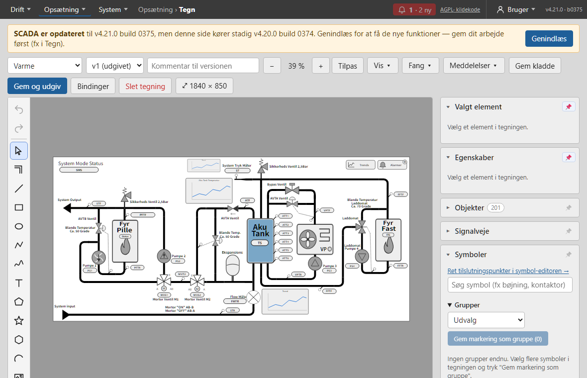

**Tegn** (under **Opsætning**, rollen tekniker) er den indbyggede tegne-editor. Brug den til at tegne anlægget, indsætte færdige **symboler** fra biblioteket og forbinde dem med **forbindelser** (rør og ledninger — se næste kapitel).

## Skærmen

- **Øverst** står én linje i tre dele:
  - **til venstre** står **tegningens navn** som en menu: skift til en anden tegning, **+ Ny tegning …**, **⤢ Størrelse …**, **Bindinger →** og nederst den røde **Slet tegning …**. Ved siden af står **versionen** (fx *v4 kladde*): tryk for at åbne en anden version eller **udgive** den åbne. En orange **●** betyder, at der er ændringer, der ikke er gemt;
  - **i midten** står menuerne **Vis** (gitter, hjælpelinjer, navne og tags i tegningen), **Fang** (fang til gitter, objekter, rør og hjælpelinjer, skalér symmetrisk) og **Forbindelser** (tjek, ret og bind forbindelser; mærket viser antal fejl eller ✓) og knapperne **Flow** og **Simulér**. **Simulér** åbner tegningen i simulatoren, og **Tegn** derovre fører tilbage. Simulatoren viser den udgivne tegning: har du ændringer, der ikke er gemt, tilbyder Tegn at gemme og udgive dem først;
  - **til højre** står **zoom** (−, +, ⤢ tilpas), **Meddelelser**, **Gem kladde** og **Gem og udgiv**. Pilen **▾** på *Gem og udgiv* åbner **kommentaren til versionen**; en grøn prik viser, at der er skrevet en.

  På en smal skærm bliver teksterne kortere (*Forb.*, 🔔, *Kladde*, *Udgiv*), så linjen ikke ombrydes.
- **Meddelelser**: systemets beskeder om tegningen (fx at den er gemt og udgivet, at der er renset noget ved gem, eller en advarsel) samles i en boks, der åbner, når du trykker på knappen — som alarmklokken i topmenuen. Et **orange tal** viser, hvor mange nye der er; en **advarsel** åbner boksen af sig selv. Dublerede symbolnavne står øverst i boksen med en knap, der giver dem unikke navne. **Gamle symbolopsætninger** (fra guiden, på elementer der ikke længere er i tegningen, fx når et symbol er slettet eller erstattet) står som én fast besked med **Fjern dem …** (du bekræfter først), **Vis i Bindinger** og **Vis navnene**. Boksen viser kun meddelelserne for den **åbne tegning**; **Vis også andre tegningers meddelelser** viser resten. **Ryd meddelelser** tømmer den åbne tegnings liste.
- **Værktøjslinjen til venstre**: **Fortryd** og **Gentag** øverst, derefter værktøjerne **Vælg** (V), **Forbindelse** (O), **Linje** (L), **Rektangel** (R), **Ellipse** (E), **Sti** (P), **Frihånd** (F), **Tekst** (T), **Polygon** (Y), **Stjerne** (S), **Regulær polygon** (N), **Bue** (B) og **Billede**. Bogstavet er genvejstasten.
- **Tegnefladen** i midten. **Ctrl + musehjul** zoomer, og **mellemrum** eller **midterknappen** + træk flytter udsnittet.
- **Linjen i bunden** forklarer, hvordan det valgte værktøj bruges (fx *Rektangel: træk for at tegne · Shift = kvadrat · Esc = tilbage til Vælg*).
- **Panelet til højre** med foldbare sektioner (se *Panelet til højre*).

## Sådan tegner du

1. Vælg en tegning i menuen med tegningens navn øverst til venstre (og en version i versionsmenuen ved siden af), eller start en ny (**+ Ny tegning …**, skriv navnet i feltet, og tryk **Opret tegning**). Står du på en tegning i **Overview**, åbner menupunktet **Tegn** (og **Bindinger**) direkte den tegning.
2. Tegn med værktøjerne til venstre, og indsæt symboler fra **Symboler** til højre — klik på et symbol, eller **træk det ind** på tegningen, hvor det skal stå.
3. Under **Valgt element** giver du elementet et **Navn**, hvis det skal være et symbol, der kan sættes op med guiden. **Avanceret** viser elementets tekniske **id**.
4. Tryk **Gem kladde** (gemmer en ny version, men viser den ikke endnu) eller **Gem og udgiv** (gemmer og gør den aktiv). En ny tegning skal have et navn.
5. **Slet tegning …** (i menuen med tegningens navn) fjerner hele tegningen (med samme oversigt over, hvad det rammer, som på siden *Tegninger*). **Bindinger** åbner bindingsiden for tegningen.

Er der ændringer, du ikke har gemt, spørger systemet, før de kasseres.

## Flere former, streg, gradient og skygge

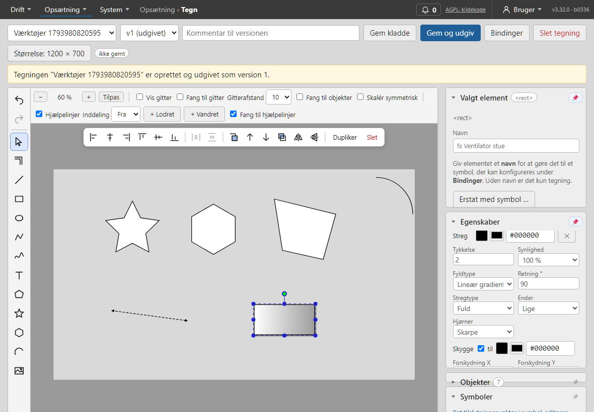

- **Polygon** (Y): klik hjørnerne et ad gangen. **Dobbeltklik** eller **Enter** afslutter (mindst 3 hjørner), og **Esc** dropper den.
- **Stjerne** (S) og **Regulær polygon** (N): træk fra midten og ud. Mens værktøjet er valgt, sætter du antal **spidser/hjørner** og stjernens **indre radius** i linjen over tegningen. Formen står lige; hold **Shift** for at dreje den med musen. Bagefter kan du ændre spidser og indre radius under *Egenskaber*. Formen bliver stående samme sted og i samme størrelse.
- **Bue** (B): klik **midten**, så **startpunktet** (det giver radius) og så **slutpunktet**. Buen går med uret. Hold **Shift** for vinkler i trin på 15°.
- **Billede** (knappen med billedet nederst i værktøjslinjen): vælg en PNG, JPG, WebP eller GIF på højst 2 MB. Billedet indlejres i tegningen og skaleres til højst 60 % af den. Store billeder gør tegningen tung, så brug små billeder.

Under **Egenskaber** for en figur:

- **Fyldtype**: *Ensfarvet*, *Lineær gradient* (med **retning** i grader, 90 = fra venstre mod højre) eller *Radial gradient*. Farverne vælges som *fra* → *til* ud for *Fyld*.
- **Stregtype** (*Fuld*, *Stiplet*, *Prikket*, *Stiplet-prikket*). Mønstret følger stregens tykkelse. Desuden **Ender** (lige, runde eller firkantede) og **Hjørner** (skarpe, runde eller afskårne).
- **Pile** på en linje eller sti: *i starten* og/eller *i slutningen*, i stregens farve.
- **Skygge**: sæt hak i *til*, og ret farve, forskydning og sløring.

**Lag** (øverst i *Objekter*): opret et lag med navn og **Opret**. Klik på et lag for at gøre det **aktivt**, så nye elementer tegnes dér (●). For hvert lag er der knapperne:

- **Vis/Skjult** skjuler laget i Tegn.
- **Lås** gør, at lagets elementer ikke kan vælges. Det er praktisk til en baggrund.
- **Flyt hertil** flytter det valgte til laget.
- **Omdøb** og **Slet** (kun et tomt lag).

Skjul og lås gælder kun i Tegn. Den gemte tegning og Overview viser altid alle lag.

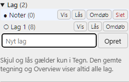

**Rækkefølge:** **↑** og **↓** i knaplinjen over det markerede (eller **Ctrl+]** og **Ctrl+[**) flytter det valgte ét trin frem eller tilbage. *Læg øverst* og *Læg nederst* flytter helt op eller ned.

## Vælg, flyt og markér

- **Klik** vælger et element; **Shift+klik** eller en **ramme** vælger flere. Træk for at flytte, træk i et hjørne for at ændre størrelsen, og træk i den grønne prik for at dreje.
- **Symboler oven i hinanden:** hold **Alt** nede og klik. Så vælges elementet, der ligger *bagved* det valgte på samme sted; klik igen med Alt for at gå et lag længere ned. Du kan også vælge elementet i **Objekter**.
  - **Træk** derefter (uden Alt) for at flytte det valgte. Det forreste bliver liggende.
  - Et **klik uden at trække** vælger det forreste igen.
- **Knaplinjen over det markerede**: justér (venstre, midte, højre, top, midte, bund), fordel vandret/lodret (mindst 3), ét trin frem/tilbage, læg øverst/nederst, spejl, **Gruppér**/**Opløs**, **Dupliker** og **Slet**.
- **Højreklik** giver klip, kopiér, indsæt, dupliker, gruppér, rækkefølge og slet.

## Taster

Alt kan fortrydes med **Ctrl+Z** (**Ctrl+Y** gentager). **Delete** sletter, **Ctrl+C/X/V** kopierer/klipper/indsætter, **Ctrl+D** duplikerer, **Ctrl+G** grupperer (**Ctrl+Shift+G** opløser), **Ctrl+A** vælger alt, piletasterne flytter 1 (med **Shift** 10), **Ctrl+0** tilpasser zoom, **Ctrl+]**/**Ctrl+[** flytter ét trin frem/tilbage, og **Esc** går tilbage til Vælg. Tasterne virker ikke, mens du skriver i et felt — klik i tegningen først.

## Panelet til højre

Panelet består af foldbare sektioner. Klik på en overskrift for at folde den ud — de andre foldes så sammen, undtagen dem du har **fastgjort med 📌** (de står altid åbne; valget huskes i browseren). Fra start er *Valgt element* og *Egenskaber* fastgjort.

- **Valgt element**: navn, **Opsæt symbol (6 trin)**, **Kopiér opsætning**, **Erstat med symbol …**, **Ret tilslutningspunkter …** og **Farver**.
- **Egenskaber**: placering (X/Y), størrelse (B/H), drejning, hjørner, fyld (også gradient), streg (type, ender, hjørner, pile), tykkelse, synlighed og skygge — skriv en værdi og tryk **Enter**. For tekster og forbindelser er der flere felter (se *Tekst* og kapitlet *Forbindelser*).
- **Objekter**: tegningens **lag** (se ovenfor) og alle elementer, forrest øverst. Klik vælger (også et element, der ligger skjult under et andet), **Ctrl-klik** vælger flere, og **▲▼** flytter det valgte frem eller tilbage.
- **Symboler**: symbolbiblioteket og grupper (se *Symbolbiblioteket* og *Grupper af symboler*).

## Tekst

Vælg værktøjet **Tekst** (T), klik og skriv; dobbeltklik på en tekst for at rette den direkte. Når en tekst er valgt, har *Egenskaber* en tekst-del:

- **Tekst** — ret teksten i feltet; **Enter** giver en ny linje (teksten står så på flere linjer). Klik uden for feltet for at gemme.
- **Størrelse** (skriv eller vælg fra listen) og **Skrifttype**.
- **F**, **K**, **U** — fed, kursiv og understreget (klik igen for at slå fra).
- **Justering** — venstre-, centreret eller højrestillet; teksten bliver stående samme sted.
- **Farve** — tekstens farve.

## Tegningens størrelse

**⤢ Størrelse …** i menuen med tegningens navn viser og ændrer tegningens bredde og højde. Vælg et **fast valg** (fx *Full HD-skærm 1920 × 1080* eller *Panel 1280 × 800*) eller skriv bredde og højde (100–10000), og tryk **Brug størrelsen**. **Tilpas til indholdet** flytter tegningen op i hjørnet og gør den præcis stor nok med den valgte margen. En baggrund, der fyldte hele tegningen, følger med. Nye tegninger starter på 1200 × 700, og Overview skalerer altid tegningen til skærmen.

## Tegnehjælp: gitter, fang og drejning

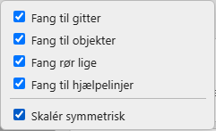

Tegnehjælpen ligger i menuerne **Vis**, **Fang** og **Forbindelser** i den øverste linje (tryk på menuen, sæt hak, og klik udenfor eller tryk Esc for at lukke den):

- **Vis gitter** viser et net **ovenpå** tegningen (det ændrer ikke tegningen). Linjerne ligger med den valgte **gitterafstand** (5, 10, 20, 25 eller 50 enheder), og hver 5. linje er kraftigere.
- **Tjek forbindelser** (menuen **Forbindelser**) markerer alle symboler og rør oven på tegningen, så du kan se, om alt hænger sammen: **grønt** = alle tilslutningspunkter sidder fast i noget, **rødt** med røde prikker = der er åbne ender (**stiplet kant** = intet er forbundet). Menuen viser, hvor mange der har åbne ender, og deres navne; mærket på knappen viser antallet af fejl (eller et grønt ✓). Ubrugte tilslutningspunkter på et symbol (fx en pumpes ekstra port) vises også som røde prikker — det er ikke nødvendigvis en fejl. Det er kun en visning, der ikke gemmes. **Flowberegningens beskeder** står også her, fx *Pumpen 'P1' er ikke forbundet på IND og UD — de gemte forbindelser peger på øverst, nederst*. En **gemt forbindelse til et punkt, symbolet ikke længere har** (fx efter at symbolets punkter er ændret, eller symbolet er erstattet), vises som **gledet** (orange). **Bind forbindelser** fjerner den og binder det rigtige punkt. De tæller med i mærket. Er alt forbundet, men flowet kan ikke beregnes, står der **Hænger sammen, men flowet kan ikke beregnes**. Så viser Tegn det samme som simulatoren og Overview.
- **Punkter og symboler, der ikke er i brug**: nogle tilslutningspunkter bliver aldrig brugt (fx en pumpes ekstra port), og nogle symboler skal slet ikke have rør. Så skal de ikke give en fejl. Mens **Tjek forbindelser** er slået til, kan du **klikke på den røde prik** for at markere punktet som **ikke i brug** — det bliver en grå stiplet ring og tæller ikke som en fejl. **Skift+klik** på en prik (eller vælg symbolet og tryk **Udelad valgte fra tjekket**) udelader **hele symbolet**: det får en grå ramme med et ⊘-mærke. Klik på ringen eller mærket for at fortryde. Markeringerne **gemmes i tegningen**, når du trykker **Gem kladde** eller **Gem og udgiv**, og kan fortrydes med Ctrl+Z. De påvirker kun tjekket, ikke Overview.
- **Bind forbindelser** gemmer det, der hænger sammen, **som en del af tegningen** (gemmes, når du trykker Gem kladde eller Gem og udgiv). Uden gemte forbindelser gætter Tegn hver gang ud fra, hvor tæt tingene ligger; med dem er det de gemte forbindelser, der gælder for tjekket. Knappen viser, hvor mange nye forbindelser der er at gemme. Bagefter viser tjekket:
  - **grønt** — gemt, og punkterne mødes;
  - **orange** — gemt, men punkterne er **gledet fra hinanden** (fx et rør, der er blevet kortere). **Ret** flytter rør-enden tilbage; **klik på den orange prik** fjerner forbindelsen (Ctrl+Z fortryder);
  - **rødt** — et åbent punkt.
  Punkter uden en gemt forbindelse (fx et rør, du lige har tegnet) bruger stadig afstanden, til du binder igen. En kopi (Ctrl+C/V, Ctrl+D) tager ikke forbindelserne med. Bindingen kan vise et par flere åbne punkter end før: et sted, hvor fx en bøjning er tegnet ind over et T-stykkes ben, talte afstanden tidligere bøjningens kurvepunkt som en forbindelse — det gør den gemte forbindelse ikke.
- **Ret N forbindelser** (i menuen **Forbindelser**, når der er noget at rette) flytter rør-ender, der ligger **klods op ad** en anden ende eller et tilslutningspunkt (mere end 8, men højst 25 enheder fra), så de sidder sammen. Et tegnet rør lægges om og sættes fast i punktet; et lige rør-symbol (rør vandret/lodret) forlænges eller forkortes i sin egen retning, hvis målet ligger på dets linje. **Symboler flyttes aldrig**, og ender længere væk end 25 enheder, eller som ligger ved siden af røret, rettes ikke — dem må du selv trække på plads. Det hele er ét fortryd-trin (Ctrl+Z).
- **Vis navne** (symboler / forbindelser) skriver navnene som mærkater **oven på** tegningen, så du kan se, hvad ting hedder, når du fx sætter bindinger op. Symbolernes navne står i blåt over symbolet, forbindelsernes (rør, bøjninger, T-stykker) i grønt. Et tegnet rør uden navn vises med sit id i grå kursiv. Navnene gemmes ikke i tegningen og vises ikke i Overview; valget huskes i din browser.
- **Vis tags** (hak ved **tags** under *Navne i tegningen*) skriver de PLC-tags, hvert symbol bruger, i lilla **under** symbolet: tags fra symbolets opsætning i guiden (signaler, tilbagemeldinger, animationer, flow) og fra elementets bindinger. Højst fire linjer pr. symbol (*+n flere*). Listen er den **gemte** opsætning og hentes igen, når du lukker guiden; bindinger sat op under *Bindinger* ses, når du åbner Tegn igen. Kun visning, som navnene.
- **Fang til gitter** lægger objekter på gitteret: når du flytter, indsætter eller duplikerer, flyttes objektets **øverste venstre hjørne** til nærmeste gitterpunkt.
- **Fang til objekter**: slipper du et objekt tæt på et andet, lægger det sig **kant mod kant** eller **midte mod midte** med det nærmeste. Små justeringer med piletasterne fanges ikke.
- **Skalér symmetrisk**: trækker du i et hjørne, ændres bredde og højde i samme forhold. Hold **Shift** nede for at skalere frit (uden indstillingen er det omvendt).
- **Drejning** sker i **15°-trin**. Hold **Shift** nede, mens du drejer, for at dreje **frit**.

Indstillingerne huskes i din browser.

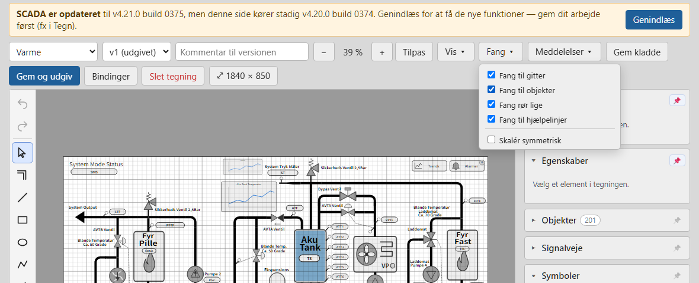

## Hjælpelinjer

Hjælpelinjer er linjer, du bygger tegningen op efter. De **gemmes i tegningen** (så alle, der redigerer den, ser dem), men vises **kun i Tegn** — aldrig i Overview eller drift.

- **Hjælpelinjer** viser/skjuler dem (sletter dem ikke).
- **Inddeling** (Fra/50/100/200/250) lægger faste, stiplede linjer med den afstand over hele tegningen.
- **+ Lodret** / **+ Vandret** lægger en fri linje midt i det, du ser. Træk i linjen for at flytte den (positionen vises undervejs); træk den ud over kanten — eller klik på den og tryk **Delete** — for at fjerne den.
- **Fang til hjælpelinjer**: symboler (kant eller midte), forbindelser og deres stykker fanges til linjerne, når de er tæt på. Hjælpelinjerne går forud for gitter og objekter. Mens du trækker et symbol, lyser den linje, det vil blive fanget til, **orange**, og en orange prik viser, hvilken kant eller midte der fanges (med positionen ved siden af). Når du slipper, blinker linjen kort.
- **Justér til en linje:** klik på en fri linje, så den bliver **blå (aktiv)**. Knaplinjen over det markerede viser *til lodret/vandret hjælpelinje* — venstre/midte/højre justerer til en lodret linje, top/midte/bund til en vandret. **Esc** slipper linjen.

## Farver på de valgte symboler

Vælg et eller flere symboler, så viser *Valgt element* feltet **Farver** med de farver, markeringen bruger. Tryk på en farve og vælg en ny — så skiftes den farve i **alle** de valgte symboler på én gang, både fyld og streg. De andre farver røres ikke. **Ctrl+Z** fortryder skiftet i ét trin.

> Farven her er symbolets **grundfarve** i tegningen. Har symbolet en animation (fx *Farve* eller *Løbelys*), bestemmer animationen farven på Overview, når den er aktiv.

## Symbolbiblioteket

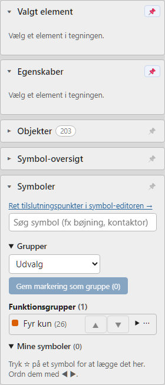

Sektionen **Symboler** til højre er **symbolbiblioteket**, sorteret i kategorier (*Betjening*, *Proces og visning*, *Rør og VVS*, *Elektrisk*, *Solcelleanlæg*, *Genveje* og *Egne symboler* — se nedenfor). Søg efter et symbol (fx *bøjning* eller *kontaktor*). **Klik** på det for at sætte det ind midt på tegningen, eller **træk** det ind, hvor det skal stå. Hvert indsat symbol får et **navn** (fx *Pumpe 2*), som du kan ændre.

Et nyindsat symbol skal **sættes op**: vælg symbolet og tryk **Opsæt symbol (6 trin)**. Tegningen gemmes og udgives først (du bliver spurgt), fordi guiden arbejder på den aktive version. Se *Symboler og guiden*.

**Mine symboler**: tryk **☆** i hjørnet af et symbol for at lægge det i *Mine symboler* øverst i biblioteket (stjernen bliver fyldt **★**); tryk igen for at tage det ud. **◀** og **▶** flytter et symbol frem eller tilbage. Listen gemmes på serveren for din bruger. Plads til højst 60 symboler.

**Navne skal være unikke.** Har flere symboler samme navn, viser Tegn en advarsel med knappen **Giv dem unikke navne**: det første beholder sit navn, de andre får det næste ledige nummer. Opsætninger og bindinger følger elementet, ikke navnet.

**Felter med tekst** (*Statusfelt*, *Værdifelt*, *Auto/Manuel*): træk i et sidegreb for at gøre feltet bredere (eller højere) — teksten bliver ikke strakt, og et statusfelt beholder sine runde ender.

**Genveje** (kategorien *Genveje*): knapperne **Gå til Alarmer**, **Gå til Trends** og **Gå til Energi**. Et klik på dem i Overview åbner siden. Alarmknappen viser **antallet af aktive alarmer** — orange når de er kvitteret, rødt og blinkende når der er ukvitterede. På et driftpanel åbner *Gå til Alarmer* og *Gå til Trends* siderne uden menu, med *Tilbage* til tegningen.

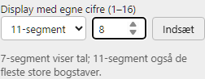

**Display med egne cifre**: under *Proces og visning* vælger du **7-segment** eller **11-segment** og et antal **cifre (1–16)** og trykker *Indsæt*. Sæt displayet op med guiden (se *Segment-display* i *Symboler og guiden*).

**Omskifter med egne positioner**: under *Betjening* kan du skrive positionernes navne (2–8, adskilt med komma, fx *Hånd, 0, Auto*) og indsætte en omskifter med lige det antal positioner.

> Rør og fittings (bøjninger, T-stykker, kryds) i biblioteket er tegnet i samme tykkelse, så de passer sammen. T-stykker og kryds består af selvstændige rør, så hvert rør kan få sit eget løbelys; et ældre T-stykke/kryds (én sti) deles med **Del i rør** i *Valgt element*.

## Egne symboler: gem et objekt som symbol

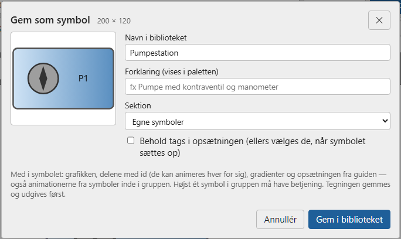

Har du tegnet noget, du vil bruge igen (fx en pumpestation med kasse, pumpe og tekst), kan du gemme det som et **nyt symbol i biblioteket**. Det kræver rollen *tekniker* eller *admin*.

1. Vælg objektet eller gruppen. Er det flere løse dele, så gruppér dem først (**Ctrl+G**) og vælg gruppen.
2. Tryk **Gem som symbol i biblioteket …** i *Valgt element*. Tegningen gemmes og udgives først (du bliver spurgt).
3. Giv symbolet et **navn** og evt. en **forklaring**, og vælg **sektion** (standard: *Egne symboler*).
4. Tryk **Gem i biblioteket**.

**Det kommer med:** grafikken, alle **dele med id** (de kan animeres hver for sig i guiden — en del, der kom fra et bibliotekssymbol, beholder sit navn, fx *loebehjul*), **gradienter og markører** som delene bruger, og **opsætningen fra guiden** — både gruppens egen og animationerne fra symboler inde i gruppen. **Tags** fjernes som standard, fordi de hører til anlægget; sæt hak i **Behold tags i opsætningen**, hvis de skal med. Nøglelås og kode kommer aldrig med.

**Højst én betjening:** et symbol har én betjeningsform. Har flere symboler i gruppen hver deres betjening (fx to trykknapper), afvises det med en besked om hvilke. Gør de andre til *Kun passiv visning* i guiden, eller gem dem som hvert sit symbol.

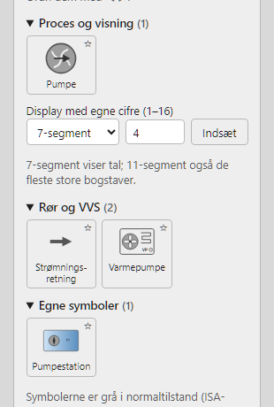

**Brug symbolet:** det står i sektionen *Egne symboler* (eller den sektion, du valgte) og indsættes, søges og lægges i *Mine symboler* som de indbyggede. **Opsæt symbol (6 trin)** starter med symbolets egen opsætning — vælg tags i trin 2 og 4.

**Ny version:** gemmer du igen med **samme navn**, bliver det en ny version af symbolet (dialogen siger *Gem som version 2*). Tegninger, der allerede bruger symbolet, **ændres ikke** — hvert symbol i en tegning er en kopi. Vil du opdatere dem, så vælg symbolet og tryk **Erstat med symbol …**: det første forslag er *Nyeste version* af symbolet (se *Opdatér gamle symboler* nedenfor).

## Importér SVG-symboler og organisér biblioteket

**Siden Symboler** (*Opsætning*, rollen tekniker) har **symbolet i centrum**:
- Vælg et symbol i listen til venstre (søg og kategori). Mærkerne viser *eget*, rettede *punkter* og *ind/ud*.
- Til højre står **symbolets panel**: forhåndsvisning, navn og knapperne **Redigér grafik**, **Omdøb** og **Slet** (egne symboler) og **Sektion** (flyt symbolet til en anden sektion).
- Under dem står fanerne **Tilslutningspunkter** og **Ind/ud og veje** for det samme symbol (kapitel 8). Symbolet følger med, når du skifter fane. Har du ændringer, der ikke er gemt, spørger siden først.
- **Organisér bibliotek …** øverst samler det, der gælder hele biblioteket: sektioner, rækkefølge, flere symboler ad gangen, import og eksport. **Åbn** på en række går til symbolets panel.

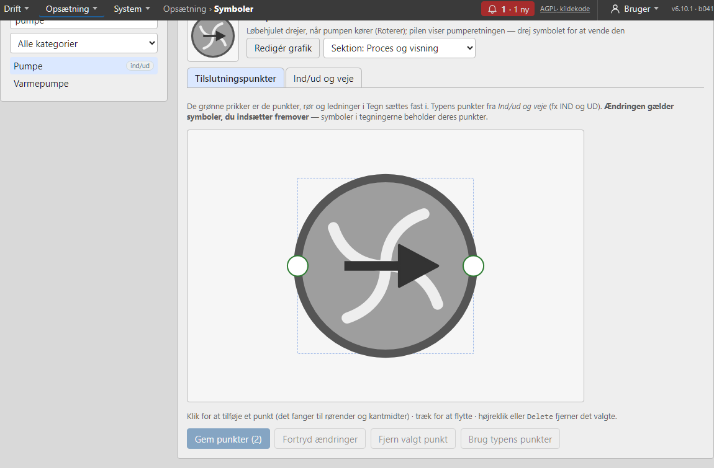

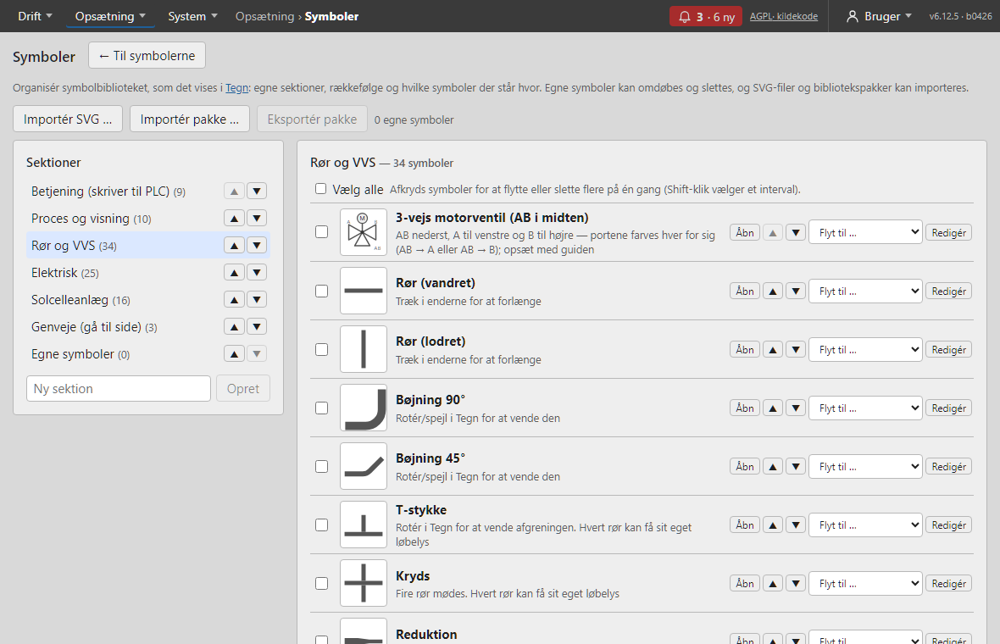

**Importér SVG-filer:** tryk **Importér SVG-symboler …** øverst i *Symboler* i Tegn, eller **Importér SVG …** under **Organisér bibliotek …** på siden **Symboler** (*Opsætning*). Vælg en eller flere `.svg`-filer (højst 50 og 10 MB i alt) og en **sektion**, og vælg hvad der skal ske, hvis et symbol med samme navn findes: *Opret med nyt navn* ("Navn 2"), *Gem som ny version* eller *Spring over*. Hver fil bliver **ét symbol** med filnavnet som navn.

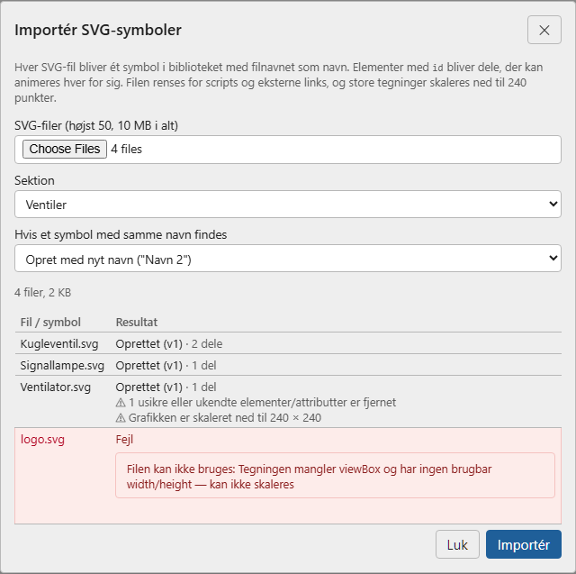

- **Dele:** elementer med `id` i filen bliver dele, der kan animeres hver for sig i guiden (fx en *lampe* eller en *rotor*).
- **Rensning:** filen renses som en uploadet tegning — scripts, eksterne links og ukendte elementer fjernes. CSS i filen (fx `path,rect{fill:none;stroke:#000}`, `.st0{…}` eller `rect.w{…}` fra Illustrator, Inkscape og andre symbolsæt) skrives ind på elementerne. Andre regler (fx `svg rect` eller `a:hover`) kan ikke bruges og giver én samlet advarsel.
- **Størrelse:** filen skal have `viewBox` eller `width`/`height`. Grafik større end 240 punkter skaleres ned.
- Resultatet vises pr. fil: *Oprettet*, *Ny version*, *Sprunget over* eller *Fejl* med begrundelsen. En fil med fejl stopper ikke de andre.

**Sæt en SVG-fil ind i tegningen:** tryk **Indsæt SVG-fil …** i *Symboler* (eller træk en `.svg`-fil fra computeren ind på tegnefladen). Filen bliver **én gruppe** i tegningen med filnavnet som navn — ikke et bibliotekssymbol — og skaleres ned, så den højst fylder 60 % af tegningen. Den renses på serveren (som ved import), og gradienter og andre id'er får nye navne, så de ikke støder sammen med tegningens egne. Fortryd med **Ctrl+Z**. Gruppen kan redigeres som alt andet og bagefter gemmes som symbol (*Gem som symbol i biblioteket …*).

**Organisér biblioteket** (siden *Symboler* › **Organisér bibliotek …**, rollen tekniker):

- **Sektioner:** opret en sektion med navn og **Opret**, flyt sektioner op og ned med **▲ ▼**, og omdøb (**✎**) eller slet (**🗑**) dine egne sektioner. Sletter du en sektion, flyttes egne symboler til *Egne symboler* og indbyggede tilbage til deres kategori.
- **Symboler:** vælg en sektion til venstre. Flyt et symbol op og ned med **▲ ▼**, eller til en anden sektion med **Flyt til …** — det gælder også de indbyggede symboler. Egne symboler kan omdøbes og have en forklaring (**✎**) og slettes (**🗑**). Tegninger, der bruger et slettet symbol, beholder deres kopi; siden siger hvilke.
- **Redigér grafikken:** tryk **Redigér grafik** i symbolets panel (eller **Redigér** ved et symbol under *Organisér bibliotek*). Der åbnes en lille arbejdstegning i Tegn med symbolet valgt og en gul linje øverst.
  1. Ret stregerne og farverne. *Opløs* gruppen for at rette enkelte dele, og *Gruppér* dem igen med **Ctrl+G**.
  2. Vælg det samlede symbol.
  3. Tryk **Gem i biblioteket**.

  Et **eget** symbol gemmes som en ny version med samme navn; standardopsætningen beholdes, så længe delene findes endnu. Et **indbygget** symbol kan ikke ændres, så det gemmes som en kopi, "… (egen)". Bagefter tilbydes at slette arbejdstegningen og gå tilbage til symbolet. Tegninger med den gamle version ændres ikke — opdatér dem med *Erstat med symbol*.
- **Flere på én gang:** afkryds symbolerne (eller **Vælg alle**; **Shift**-klik vælger alle mellem to afkrydsninger). Over listen kan du så **Flyt valgte til …** en anden sektion eller **Slet valgte**. Kun egne symboler kan slettes; indbyggede i valget bliver stående. Sletningen sker samlet: findes et af symbolerne ikke længere, slettes intet.
- Rækkefølgen er den samme i Tegn for alle brugere. Ændrer to personer opdelingen samtidig, afvises den sidste med en besked — prøv igen.

**Bibliotekspakke** (flyt egne symboler til en anden SCADA): **Eksportér pakke** henter alle egne symboler som én fil (`.hvlib.json`) med grafik, standardopsætning og sektion — **uden tags**, fordi de hører til anlægget. På den anden SCADA trykker du **Importér pakke …**, vælger filen og hvad der skal ske ved samme navn. Sektioner, der mangler, oprettes.

**Symboltest** og symbolets panel (tilslutningspunkter, ind/ud og veje) virker også for egne symboler — vælg *Egne symboler* i listen over kategorier.

## Symbol-oversigt: alle symboler ét sted

Panelet **Symbol-oversigt** (til højre) viser alle symboler på tegningen som et **træ**, så du ikke skal lede efter dem rundt i editoren:

- **Niveau 1:** *Grundsymboler* (bibliotekssymboler og navngivne elementer) og *Grupper*.
- **Niveau 2:** folder du en gruppe ud, ser du dens medlemmer. Et symbol kan stå flere steder (fx som medlem af to grupper).
- **Klik på navnet** vælger symbolet (en gruppe: alle dens medlemmer) på tegningen. **Opsæt** åbner symbol-guiden (6 trin) for symbolet. På en gruppe åbner **Animationer** gruppens animationer.
- Et ✓ viser, at symbolet har en opsætning. Tallet øverst viser, hvor mange grundsymboler der er opsat. Søgefeltet og *ikke opsatte* indsnævrer listen til det, du mangler.
- Har symboler **intet navn**, står der en advarsel med knappen **Giv dem unikke navne**: hvert navnløst symbol får typens navn og et løbenummer (*3-vejs ventil 2*), så to ens symboler kan kendes fra hinanden. Ét fortryd-trin (Ctrl+Z); gem tegningen for at beholde navnene.
- Oversigten opdateres selv, når du gemmer en opsætning eller ændrer tegningen.

## Grupper af symboler

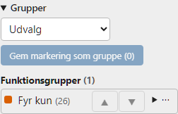

Vælg flere symboler og tryk **Gem markering som gruppe** i sektionen **Grupper** (under *Symboler*). Giv gruppen et navn og en art: **Funktionsgrupper** er en del af anlægget med en funktion, fx *Fyr uden akku-tank*; **Udvalg** er et frit udvalg. Tryk på gruppens navn for at markere alle dens symboler igen. Under **⋯** kan du tilføje eller fjerne de valgte, sætte gruppen til de valgte, omdøbe, flytte den mellem de to arter eller slette den (symbolerne slettes ikke).

Samme symbol må gerne være med i flere grupper. Er det valgte symbol med i grupper, står de nævnt under listen — og øverst i **Opsæt symbol**. Gem tegningen før du laver grupper.

**Animationer på en gruppe:** under **⋯ › Animationer …** (eller på siden Bindinger, når du har valgt en gruppe) sætter du animationer op for hvert symbol i gruppen — fx farver alle gruppens rør, når *Fyr kører*. Gruppens animationer gælder **ud over** symbolets egne og andre gruppers; hver gruppe har sin egen farve, og de andre ejeres animationer vises skrivebeskyttet. Flere animationer af samme slags på samme del: den øverste *aktive* vinder; uden "passiv" vinder den sidste, og gruppernes kommer efter symbolets egne. **Samme animation til alle:** fanen **Alle medlemmer** sætter samme animationer op på hele gruppen i ét hug (anvendes på *Hele symbolet*).

Fjerner du et symbol fra gruppen, fjernes gruppens animationer på det også. Tags, der bruges af en gruppe, kan ikke slettes. På siden **Bindinger** kan du vælge en gruppe for kun at se dens symboler.

## Erstat tegnede dele med symboler

Har du en tegning, hvor pumper, ventiler og etiketter er tegnet som almindelige figurer, kan du **erstatte dem med symboler fra biblioteket**, så de kan sættes op med guiden:

1. **Opløs en stor gruppe først:** er hele tegningen samlet i én gruppe, så vælg gruppen og tryk **Opløs gruppen**.
2. Vælg den tegnede del og tryk **Erstat med symbol …**.
3. Systemet foreslår symboler ud fra delens form (fx *Statusfelt* til en afrundet etiket, *Pumpe* til en cirkel med trekant). Du kan også søge i hele biblioteket.
4. Vælg symbolet og tilret: **navn**, **behold delens id** (så bindinger på selve delen følger med), **overtag teksten** og **stræk til at fylde**.
5. Under **Andre dele af samme slags** kan du erstatte **alle lignende** på én gang.
6. **Flere løse dele?** Marker dem alle og tryk **Erstat markeringen med symbol …** — så erstattes de samlet af ét symbol. **Spejlvend vandret** bruges, hvis den tegnede ventil vender omvendt.
7. Tryk **Erstat**. Symbolet får samme **midte, størrelse og drejning** som den gamle del. **Ctrl+Z** fortryder hele erstatningen.
8. Tryk **Gem kladde**. Overview viser stadig den gamle version, til du udgiver den nye.

**Opdatér gamle symboler:** er et symbol fra biblioteket kommet i en ny udgave, så vælg et af de gamle og tryk **Erstat med symbol …** — forslaget er den nyeste udgave. Med **Behold delens id** beholder symbolet navn, placering, drejning, størrelse og opsætning (animationer på *Hele symbolet*). **Også de N lignende** opdaterer alle af samme slags på én gang.

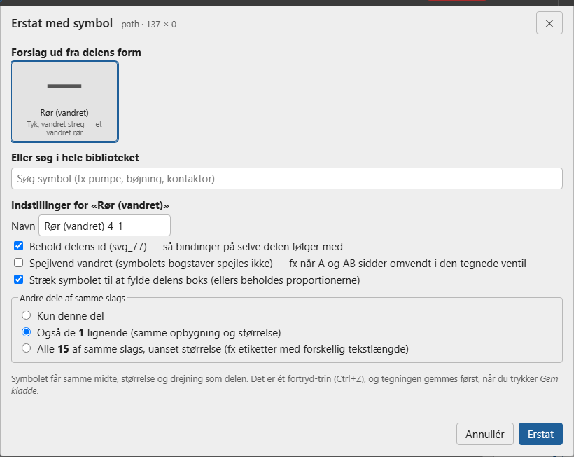

> **Retning og akse:** for en **pumpe** og en **kontraventil** aflæser systemet, hvilken vej den tegnede trekant peger, og drejer symbolet; for en **ventil** af to trekanter aflæses, om den står vandret eller lodret. For andre symboler kan retningen ikke aflæses sikkert — kontrollér og drej dem efter erstatning. Bindinger på **underelementer** i den gamle del følger ikke med; dialogen advarer, hvis der er nogen.

## Simulator: prøv tegningens tilstande

**Opsætning › Simulator** (eller **Simulér** på Overview og i menuen med tegningens navn i Tegn) viser den udgivne tegning, som den ville se ud med de værdier, du selv indskyder. Intet skrives til PLC'en, og det, du sætter, ses kun på siden.

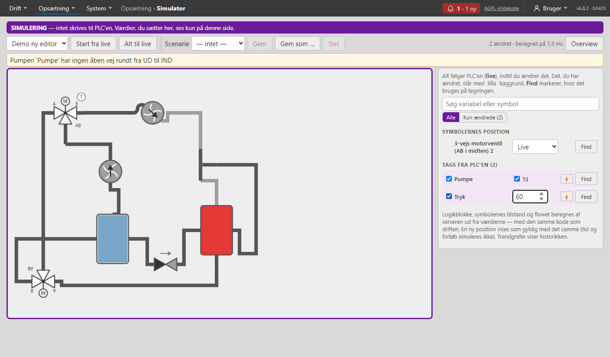

- **Panelet til højre** viser alle de variabler, tegningen bruger. Systemet finder dem selv:
  - **tags fra PLC'en** fra bindinger, symbolernes signaler og tilbagemeldinger, animationer, logik og flow;
  - **symbolernes position**;
  - **alarmer**, som animationer styres af.

  Under hvert tag står dets beskrivelse og de symboler, der bruger det, fx *Tank (Farve, opsætning)*. Kun symboler, der findes i tegningen, kommer med. Opsætninger på elementer, der er fjernet fra tegningen, nævnes øverst med et link til **Bindinger**, hvor de kan flyttes eller fjernes.
- **Sådan simulerer du en variabel:** sæt hak ud for den, og vælg værdien:
  - til/fra med et hak;
  - et tal i feltet eller med skyderen (fra tagets min/max);
  - en position i listen.

  Uden hak følger variablen PLC'en (*live*). En position står på **Live: …** (efter kolon: positionen lige nu), indtil du vælger en anden.
- Det, du har ændret, står med **lilla** baggrund. **Alle** / **Kun ændrede** øverst i panelet viser alle variabler eller kun dem, du har ændret.
- **⚡** (komm.fejl) viser, hvordan tegningen ser ud, når tagget har en kommunikationsfejl; tryk igen for at give det en værdi. Knappen virker, når der er hak ved tagget. **Find** markerer de symboler, der bruger variablen. Rækkerne står stille: værdi, ⚡ og *Find* har faste pladser.
- **Frys på live-værdier** kopierer PLC'ens værdier lige nu ind som simulerede, så de står fast, mens du ændrer én ting ad gangen. Det, du selv allerede har ændret, bevares. Knappen er slået fra, når alt allerede er simuleret, eller når PLC'en ikke svarer (så er der ingen live værdier at fryse).
- **Nulstil alle ændringer** fjerner alle simulerede værdier og positioner, så alt følger PLC'en (*live*) igen. Gemte scenarier ændres ikke.
- **Scenarier:** **Gem som …** gemmer de simulerede værdier med et navn (fx *Pumpe 2 fejl*). Vælg et scenarie for at hente det igen, **Gem** opdaterer det, og **Slet** fjerner det. Scenarierne gemmes pr. tegning og følger med i backup.
- Serveren beregner **logikblokke**, **symbolernes tilstand** og **flowet** ud fra værdierne med den samme kode som driften, så løbelys, farver, blink og tilstandsmærker vises, som de ville i drift.

> Første version: tid og forløb simuleres ikke (en ny position vises som gyldig med det samme), trendgrafer viser historikken, og alarmerne i topmenuen påvirkes ikke.
