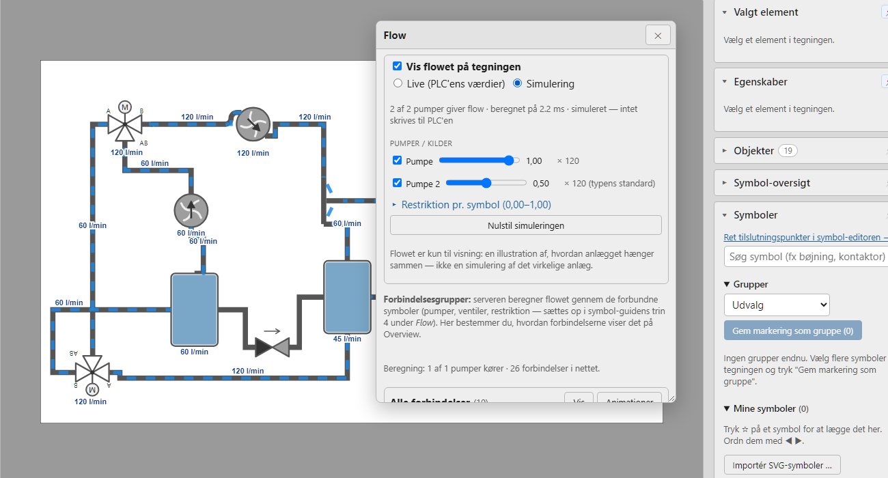
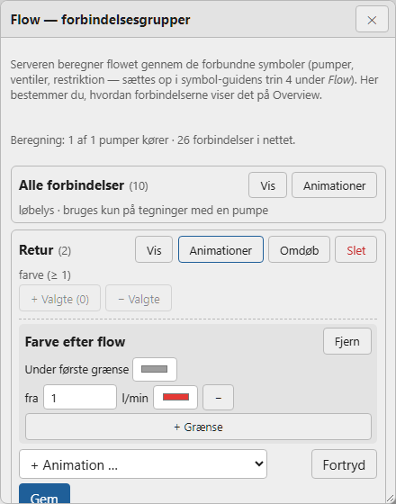

# Forbindelser (rør og ledninger)

Værktøjet **Forbindelse** (tast **O**) i *Tegn* tegner forbindelser — rør i et procesanlæg eller ledninger i en el-tegning — der altid går **vandret eller lodret** og **sidder fast** i symbolerne. Nedenfor kaldes de *rør*, men alt gælder lige så vel for ledninger.

## Tegn en forbindelse

1. Vælg **Forbindelse** (O) i værktøjslinjen. Symbolernes **tilslutningspunkter** vises som grønne prikker.
2. Klik på en grøn prik (eller et frit sted) for at starte, og klik for hvert knæk.
3. Slut på en grøn prik — så slutter røret af sig selv. Ellers: **dobbeltklik** eller **Enter**.

**Backspace** fjerner det sidste knæk, og **Esc** fortryder røret (tryk Esc igen for at gå tilbage til *Vælg*). Trykker du på selve et symbol (ikke en grøn prik), mens værktøjet er valgt, skifter Tegn til **Vælg**, så du kan flytte symbolet. Nye rør lægges bag de symboler, de forbinder.

## Tilslutningspunkter og retning

Et rør, der starter eller slutter på en grøn prik, **sidder fast**: flytter, drejer, spejler eller ændrer du størrelse på symbolet, følger røret med, og **Ctrl+Z** fortryder begge dele på én gang.

Mens du **trækker** et symbol, vises rørene, som de kommer til at ligge. De gamle rør dæmpes imens, så du kan se, hvor symbolet passer.

**Fang rør lige** (slået til som standard, ved siden af *Fang til objekter*): kommer symbolets tilslutningspunkt tæt på at flugte med rørets næste knæk, vises en **blå stiplet linje**. Slipper du, fanges symbolet, og røret står **snorlige** ud af det, uden hak. Det fanger kun inden for få skærmpunkter; flytter du længere, følger røret med med knæk som før. Hjælpelinjer vinder stadig over dette fang.

Hvert punkt har en **retning** ud af symbolet. Røret går altid et lille stykke **lige ud** af punktet, før det knækker, så det aldrig går ind gennem symbolet — også når symbolet er drejet. Mellem to sidepunkter laves et pænt Z-formet rør.

Punkterne findes automatisk ud fra symbolets **streger** (rørender på kanten; tekster som *A*, *B* og *M* tæller ikke med). Passer de ikke til et symbol, kan de rettes på siden **Symboler** (se *Tilslutningspunkter (siden Symboler)* nedenfor).

## Vælg et rør: håndtag

Vælg røret med **Vælg** — så får det håndtag:

- **Enderne**: **grønt** = sidder fast, **orange** = fri.
- **Midt på hvert lige stykke**: et lille **blåt** håndtag.

Er røret svært at ramme, fordi et symbol ligger ovenpå, så **Alt+klik** for at vælge det, der ligger bagved, eller vælg røret i panelet **Objekter**. I *Egenskaber* til højre står rørets **Navn**, **Bøjningsradius** og knappen **Ret forbindelsen ud**.

## Flyt dele af et rør

Træk et **blåt håndtag** på tværs for at flytte det stykke; nabostykkerne strækkes med, og rørets ender bliver siddende. Flyttes det første eller sidste stykke, indsættes et knæk, så røret stadig går lige ud af punktet.

- Trækker du et stykke **tæt på linje** med et andet stykke af røret (eller en af enderne), fanges det derhen, så hakket forsvinder, og stykkerne bliver ét.
- Flytter du bagefter et symbol, **bevares dine ændringer** — kun stykket nærmest symbolet lægges om.
- Er røret blevet rodet, så tryk **Ret forbindelsen ud** i *Egenskaber*: røret lægges om mellem sine to ender med så få knæk som muligt, og tilslutningerne bevares.

## Sæt et rør fast igen

Flytter du hele røret væk fra symbolet, slipper det (enderne bliver **orange**). Træk et ende-håndtag hen på et tilslutningspunkt (grøn prik), så sættes enden fast igen, og det sidste stykke lægges om. Slipper du et andet sted, bliver enden fri. Flytter du et helt rør, så en ende lander på et tilslutningspunkt, sættes den fast af sig selv.

**Røret følger ikke med symbolet?** Så sidder enden ikke fast. Vælg røret og se på enderne: en **orange** ende er fri. Træk den hen på symbolets grønne prik, til den bliver grøn. Et rør, der er tegnet før symbolet blev flyttet eller erstattet (*Erstat med symbol*), kan have mistet sin tilslutning på denne måde.

## Saml rør ende mod ende

Trækker du et ende-håndtag hen på **et andet rørs ende** (orange prik), lægges de to rør sammen til ét. Det samme gælder med værktøjet **Forbindelse**: start eller slut på et rørs ende for at forlænge røret. Har begge rør en opsætning (et navn), lægges de ikke sammen — så går ingen opsætning tabt.

Brug det til at rydde op i en tegning med mange korte rørstykker: ét langt rør er lettere at flytte, og et løbelys løber jævnt hele vejen. Har kun det ene rør en opsætning, beholder det samlede rør den.

## T-stykker

Starter eller slutter du et rør **midt på** et eksisterende rør (en **orange prik** viser stedet) — eller slipper et ende-håndtag dér — deles røret, og bibliotekets **T-stykke** sættes ind, drejet så gennemløbet følger røret og grenen vender mod det nye rør. Alle tre rør sidder fast i T-stykket og følger med, når du flytter det. Det oprindelige rør beholder navn og opsætning på den første halvdel; den anden halvdel er et nyt rør uden opsætning. **Ctrl+Z** fortryder røret og T-stykket samlet.

## Bøjningsradius

Vælg et rør, og skriv en **Bøjningsradius** i *Egenskaber* — så får knækkene bløde bøjninger i stedet for skarpe 90°-hjørner. Nye rør får den senest brugte radius. **0** giver skarpe hjørner igen.

Radius er i tegningens enheder (samme som X/Y). Er et lige stykke kortere end to gange radius, bliver bøjningen mindre, så røret stadig passer. Løbelys og farve følger bøjningerne.

## Løbelys og animation

Et rør sættes op som et symbol: vælg røret, og tryk **Opsæt symbol (6 trin) …** under *Valgt element*. Har røret intet navn, foreslås et (fx *Rør 1*), som du kan rette, før guiden åbnes. Du kan også skrive navnet i feltet **Navn** først. I trin 4 tilføjer du fx **Løbelys** (strømning langs røret — retningen er rørets tegneretning, fra start til slut, og kan vendes) eller **Farve**. Løbelyset følger hele røret gennem knæk og bøjninger.

Et **T-stykke** er et biblioteks-symbol med tre ben (*tilløb 1*, *tilløb 2* og *midte*): sæt det op med **Opsæt symbol**, og giv hvert ben sit eget løbelys. Samme opsætning på flere rør: **Kopiér opsætning** og **Indsæt opsætning**.

## Flow i anlægget: systemet beregner det selv

Serveren **beregner selv flowet** gennem tegningens forbundne symboler og rør — du skal ikke tegne eller definere veje. Beregningen bruger:

- **de gemte forbindelser** i tegningen. Slå *Tjek forbindelser* til i menuen **Forbindelser** øverst, tryk **Bind forbindelser**, og gem tegningen. Uden gemte forbindelser er der intet flow, og Flow-vinduet siger det;
- **symbolernes flow-opsætning** i symbol-guidens trin 4 under *Flow* (kapitel 10): hvilke symboler der er **pumper** (kapacitet i l/min og flow-rate 0,00–1,00 fra et tag), hvilken **restriktion** et symbol har (et tal fra 0,00 = blokeret til 1,00 = ingen restriktion), og for en ventil med positioner **hvilke veje der er åbne** i hver position (fx *AB → A* i position A);
- symboltypens **flow-rolle** (*Opsætning › Symboler › Ind/ud og veje*), når et symbol ikke har sin egen opsætning;
- symboltypens **Ind/ud og veje** (nedenfor): en pumpe og en kontraventil giver kun flow fra IND til UD, en 3-vejsventil giver flow begge veje på AB ↔ A og AB ↔ B.

**Sådan regnes der:**

- Hver pumpe, der kører, giver *rate × kapacitet* l/min. Flowet løber rundt fra pumpens UD tilbage til dens IND.
- Ved en forgrening deler flowet sig efter grenenes **restriktion**: et symbol (radiator, tank, ventil …) er en *forbruger* med sin restriktion, og rør har næsten ingen modstand.
- En delvist lukket ventil i serie begrænser pumpens flow. En lukket vej eller en kontraventil mod strømmen stopper det.
- En pumpe, der står stille, lader flow passere i sin retning.
- Flere pumper lægges sammen.

- En **flowmåler** (et symbol med *Målt flow* i guiden, fx en flowsensor i en løkke) skalerer de pumper, der giver flow gennem den, så beregningen passer med målingen. Med en **baseline** (lavt og højt flow) får symbolet et **flow-niveau** 0,00–1,00, som animationerne kan vise (kapitel 10).

Resultatet er et tal pr. rør og symbol i l/min. På et rør har tallet **fortegn**: + løber i tegneretningen, − imod. Et rørstykke (bøjning, T-stykke, kryds) får flowet ind og ud ved hvert af sine punkter, så løbelyset viser retningen i hvert ben.

> **Kun til visning.** Flowet er en illustration af, hvordan anlægget hænger sammen — ikke en simulering af det virkelige anlæg. Tallene er relative: rørlængder, dimensioner og pumpekurver indgår ikke. Beregningen gælder én tegning ad gangen; flowet stopper ved tegningens kant.

### Se flowet i Tegn (live og simulering)

Tryk **Flow** i værktøjslinjen og sæt hak i **Vis flowet på tegningen**. Flowet tegnes oven på tegningen som blå løbelys med retning og et tal i l/min ved hvert rør. Det beregnes ud fra tegningen, **som den ser ud lige nu** — også før du har gemt — og opdateres hvert 2. sekund. Det gemmes aldrig i tegningen.

- **Live** bruger PLC'ens værdier: pumpernes rate, ventilernes position og restriktionerne fra deres tags.
- **Simulering** lader dig prøve anlægget af uden PLC: sæt hak ved de pumper, der skal køre, og træk i deres **rate** (0,00–1,00), vælg **ventilernes position**, og sæt **restriktionen pr. symbol** (0,00–1,00). En pumpe-type uden egen opsætning kører med typens standard-kapacitet. Der skrives **aldrig** noget til PLC'en. **Nulstil simuleringen** starter forfra.
- Beskeder fra beregningen (fx en pumpe uden vej rundt, eller en flowmåler, der ikke er forbundet) står øverst.

### Forbindelsesgrupper: hvordan flowet ses

Tryk **Flow** i værktøjslinjen i Tegn. Vinduet ligger **over tegningen**: træk i overskriften for at flytte det og i hjørnet for at gøre det større, og luk det med ✕ eller Esc.

- **Alle forbindelser** er standardgruppen. Alle rør og rørstykker hører til den fra start, og den viser **løbelys** efter flowet: retningen fra fortegnet og farten efter mængden. Den bruges kun på tegninger med mindst én pumpe, og aldrig oven på en animation af samme slags, som en forbindelse allerede har.
- **Ny gruppe:** vælg rør og rørstykker på tegningen (Skift+klik eller træk en ramme), giv gruppen et navn, og tryk **Opret af valgte**. En forbindelse hører til **én gruppe ad gangen**: lægges den i en ny gruppe, forlader den den gamle. **+ Valgte** og **− Valgte** ændrer en gruppe; **Vis** markerer dens forbindelser på tegningen.
- **Animationer** (højst 4 pr. gruppe, alle styret af flowet):
  - **Løbelys:** fart ved fuldt flow, og hvad der er fuldt flow (0 = tegningens største pumpe);
  - **Farve efter flow:** en farve under den første grænse og en farve fra hver grænse i l/min;
  - **Blink**, når flowet er mindst eller højst en grænse (fx *højst 0* = intet flow);
  - **Fast farve**;
  - ingen animation, hvis du fjerner dem alle.

  Tryk **Gem**; det ses på Overview med det samme.

Beskeder fra beregningen (fx *Pumpen 'P1' har ingen åben vej rundt fra UD til IND*) står øverst i vinduet. Kortet **Flowberegning** på siden Status viser antal beregninger, den seneste beregningstid og eventuelle fejl.

Rørstykker (bøjninger, T-stykker, kryds) viser løbelyset med retning i hvert ben: lyset løber væk fra det punkt, hvor flowet kommer ind.

**Påmindelse:** gemmer du en tegning med en pumpe eller med bundne forbindelser, og er der forbindelser, der ikke er bundet, kommer en advarsel i **Meddelelser** med knappen **Bind nu**. Symbol-guiden siger det også under *Flow*, når symbolet ikke er bundet.

## Tilslutningspunkter (siden Symboler)

På siden **Symboler** (rollen tekniker, under **Opsætning**), fanen **Tilslutningspunkter**, kan du rette tilslutningspunkterne for et symbol i biblioteket — også egne symboler:

- Vælg symbolet i listen. Symboler med rettede punkter er mærket **rettet**.
- **Klik** for at tilføje et punkt — det fanger til rørender og kantmidter. **Træk** et punkt for at flytte det. **Højreklik** eller **Delete** fjerner det valgte.
- **Gem punkter** gemmer. **Brug de automatiske** går tilbage til de automatisk fundne.

**Genvej fra Tegn:** vælg et bibliotekssymbol og tryk **Ret tilslutningspunkter …** under *Valgt element* (eller linket øverst i *Symboler*). Symbol-editoren åbner på symbolet, og **← Tilbage til "<tegning>"** fører dig tilbage. Har tegningen ændringer, der ikke er gemt, spørger Tegn først — gem med *Gem kladde*, før du skifter.

> Ændringen gælder **symboler, du indsætter fremover**. Symboler, der allerede står i en tegning, beholder deres punkter — så eksisterende rør flytter sig ikke.

### Ind/ud og veje

Fanen **Ind/ud og veje** (samme side) beskriver, hvordan flowet løber gennem et symbol: symbolets **flow-rolle**, punkternes navne, ind/ud og de veje, en ventil kan lave. **Flowberegningen** bruger den (se *Flow i anlægget* ovenfor). Den ændrer ikke noget i tegningen, og den gælder alle tegninger med symbolet med det samme.

- **Flow-rolle** (gælder alle symboltyper, også elektriske komponenter):
  - **Rolle:** *Forbruger* (radiator, tank, ventil …), *Pumpe / kilde* (en pumpe, eller fx en strømforsyning, der giver strøm) eller *Rørstykke / ledning* (bøjning, klemme … — hører under forbindelserne og viser flowet med løbelys).
  - **Medie:** vand (l/min), luft (m³/h), el (A) eller andet. Det bestemmer kun enheden, flowet vises i.
  - **Standard-kapacitet** for en pumpe/kilde og **standard-restriktion** (0,00–1,00) for en forbruger. De gælder, når et symbol af typen ikke har sin egen flow-opsætning i guiden, og de er guidens udgangspunkt, når du slår *Med i flowberegningen* til.
  - En profil kan gemmes uden punkter: så går flowet mellem alle symbolets forbundne punkter.

- **Navn:** giv hvert punkt et navn (A, B, AB, P, T …).
- **Rolle:** *Ind*, *Ud* eller *Begge*. En **pumpe** har *IND* og *UD*; en **kontraventil** også. Flowet kan kun løbe fra et *Ind*- eller *Begge*-punkt til et *Ud*- eller *Begge*-punkt.
- **Fælles:** markér det fælles punkt på en flervejs-ventil (AB på en 3-vejsventil).
- **Del:** delens id i symbolet (fx `port_ab`), så netop den port kan få en animation.
- **Veje:** de forbindelser symbolet kan lave. De laves som standard automatisk — hvert fælles punkt parret med hvert af de andre (*AB → A*, *AB → B*) — men kan skrives selv med **+ Vej**, fx til en 4-vejsventil (*P → A*, *P → B*, *A → T*, *B → T*).
- **Klik** for at tilføje et punkt, **træk** for at flytte det, **højreklik** fjerner det. **Gem** gemmer; **Brug standarden** går tilbage. De indbyggede symboler har standarder (pumpe, kontraventil og 3-vejs ventilerne); **Start fra tilslutningspunkterne** hjælper med andre symboler.
- Ind/ud-definitionerne følger med i backup.
