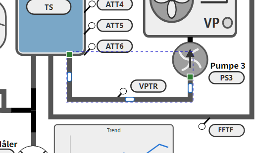
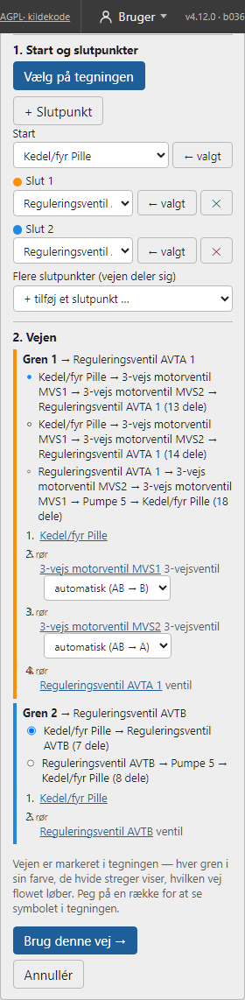
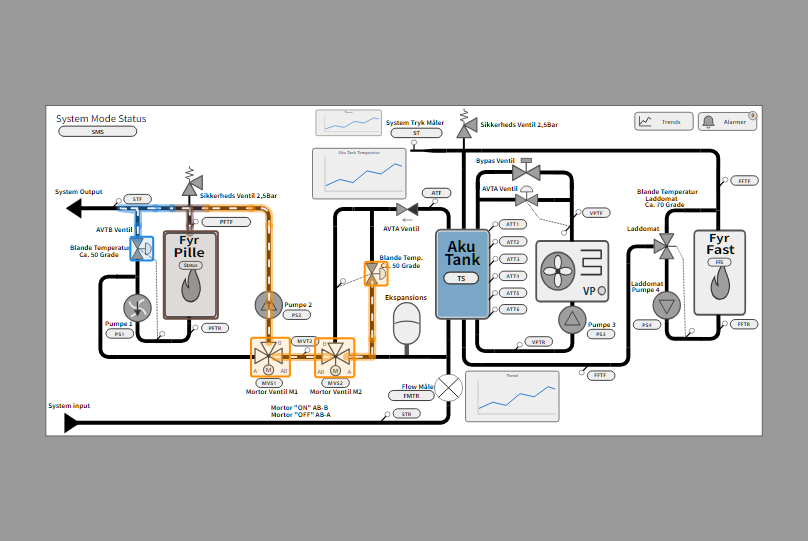
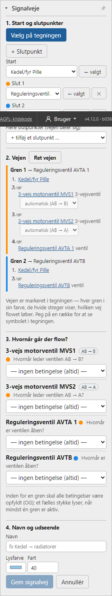
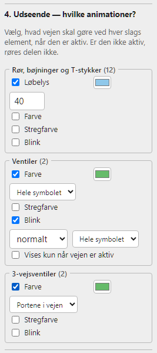
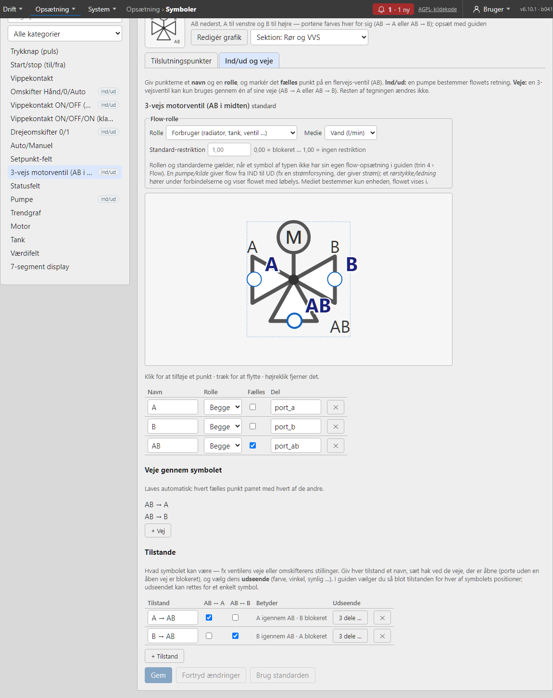

# Forbindelser (rør og ledninger)

Værktøjet **Forbindelse** (tast **O**) i *Tegn* tegner forbindelser — rør i et procesanlæg eller ledninger i en el-tegning — der altid går **vandret eller lodret** og **sidder fast** i symbolerne. Nedenfor kaldes de *rør*, men alt gælder lige så vel for ledninger.

## Tegn en forbindelse

1. Vælg **Forbindelse** (O) i værktøjslinjen. Symbolernes **tilslutningspunkter** vises som grønne prikker.
2. Klik på en grøn prik (eller et frit sted) for at starte, og klik for hvert knæk.
3. Slut på en grøn prik — så slutter røret af sig selv. Ellers: **dobbeltklik** eller **Enter**.

**Backspace** fjerner det sidste knæk, og **Esc** fortryder røret (tryk Esc igen for at gå tilbage til *Vælg*). Trykker du på selve et symbol (ikke en grøn prik), mens værktøjet er valgt, skifter Tegn til **Vælg**, så du kan flytte symbolet. Nye rør lægges bag de symboler, de forbinder.

## Tilslutningspunkter og retning

Et rør, der starter eller slutter på en grøn prik, **sidder fast**: flytter, drejer, spejler eller ændrer du størrelse på symbolet, følger røret med, og **Ctrl+Z** fortryder begge dele på én gang.

Mens du **trækker** et symbol, vises rørene, som de kommer til at ligge. De gamle rør dæmpes imens, så du kan se, hvor symbolet passer.

**Fang rør lige** (slået til som standard, ved siden af *Fang til objekter*): kommer symbolets tilslutningspunkt tæt på at flugte med rørets næste knæk, vises en **blå stiplet linje**. Slipper du, fanges symbolet, og røret står **snorlige** ud af det, uden hak. Det fanger kun inden for få skærmpunkter; flytter du længere, følger røret med med knæk som før. Hjælpelinjer vinder stadig over dette fang.

Hvert punkt har en **retning** ud af symbolet. Røret går altid et lille stykke **lige ud** af punktet, før det knækker, så det aldrig går ind gennem symbolet — også når symbolet er drejet. Mellem to sidepunkter laves et pænt Z-formet rør.

Punkterne findes automatisk ud fra symbolets **streger** (rørender på kanten; tekster som *A*, *B* og *M* tæller ikke med). Passer de ikke til et symbol, kan de rettes på siden **Symboler** (se *Tilslutningspunkter (siden Symboler)* nedenfor).

## Vælg et rør: håndtag

Vælg røret med **Vælg** — så får det håndtag:

- **Enderne**: **grønt** = sidder fast, **orange** = fri.
- **Midt på hvert lige stykke**: et lille **blåt** håndtag.

Er røret svært at ramme, fordi et symbol ligger ovenpå, så **Alt+klik** for at vælge det, der ligger bagved, eller vælg røret i panelet **Objekter**. I *Egenskaber* til højre står rørets **Navn**, **Bøjningsradius** og knappen **Ret forbindelsen ud**.

## Flyt dele af et rør

Træk et **blåt håndtag** på tværs for at flytte det stykke; nabostykkerne strækkes med, og rørets ender bliver siddende. Flyttes det første eller sidste stykke, indsættes et knæk, så røret stadig går lige ud af punktet.

- Trækker du et stykke **tæt på linje** med et andet stykke af røret (eller en af enderne), fanges det derhen, så hakket forsvinder, og stykkerne bliver ét.
- Flytter du bagefter et symbol, **bevares dine ændringer** — kun stykket nærmest symbolet lægges om.
- Er røret blevet rodet, så tryk **Ret forbindelsen ud** i *Egenskaber*: røret lægges om mellem sine to ender med så få knæk som muligt, og tilslutningerne bevares.

## Sæt et rør fast igen

Flytter du hele røret væk fra symbolet, slipper det (enderne bliver **orange**). Træk et ende-håndtag hen på et tilslutningspunkt (grøn prik), så sættes enden fast igen, og det sidste stykke lægges om. Slipper du et andet sted, bliver enden fri. Flytter du et helt rør, så en ende lander på et tilslutningspunkt, sættes den fast af sig selv.

**Røret følger ikke med symbolet?** Så sidder enden ikke fast. Vælg røret og se på enderne: en **orange** ende er fri. Træk den hen på symbolets grønne prik, til den bliver grøn. Et rør, der er tegnet før symbolet blev flyttet eller erstattet (*Erstat med symbol*), kan have mistet sin tilslutning på denne måde.

## Saml rør ende mod ende

Trækker du et ende-håndtag hen på **et andet rørs ende** (orange prik), lægges de to rør sammen til ét. Det samme gælder med værktøjet **Forbindelse**: start eller slut på et rørs ende for at forlænge røret. Har begge rør en opsætning (et navn), lægges de ikke sammen — så går ingen opsætning tabt.

Brug det til at rydde op i en tegning med mange korte rørstykker: ét langt rør er lettere at flytte, og et løbelys løber jævnt hele vejen. Har kun det ene rør en opsætning, beholder det samlede rør den.

## T-stykker

Starter eller slutter du et rør **midt på** et eksisterende rør (en **orange prik** viser stedet) — eller slipper et ende-håndtag dér — deles røret, og bibliotekets **T-stykke** sættes ind, drejet så gennemløbet følger røret og grenen vender mod det nye rør. Alle tre rør sidder fast i T-stykket og følger med, når du flytter det. Det oprindelige rør beholder navn og opsætning på den første halvdel; den anden halvdel er et nyt rør uden opsætning. **Ctrl+Z** fortryder røret og T-stykket samlet.

## Bøjningsradius

Vælg et rør, og skriv en **Bøjningsradius** i *Egenskaber* — så får knækkene bløde bøjninger i stedet for skarpe 90°-hjørner. Nye rør får den senest brugte radius. **0** giver skarpe hjørner igen.

Radius er i tegningens enheder (samme som X/Y). Er et lige stykke kortere end to gange radius, bliver bøjningen mindre, så røret stadig passer. Løbelys og farve følger bøjningerne.

## Løbelys og animation

Et rør sættes op som et symbol: vælg røret, og tryk **Opsæt symbol (6 trin) …** under *Valgt element*. Har røret intet navn, foreslås et (fx *Rør 1*), som du kan rette, før guiden åbnes. Du kan også skrive navnet i feltet **Navn** først. I trin 4 tilføjer du fx **Løbelys** (strømning langs røret — retningen er rørets tegneretning, fra start til slut, og kan vendes) eller **Farve**. Løbelyset følger hele røret gennem knæk og bøjninger.

Et **T-stykke** er et biblioteks-symbol med tre ben (*tilløb 1*, *tilløb 2* og *midte*): sæt det op med **Opsæt symbol**, og giv hvert ben sit eget løbelys. Samme opsætning på flere rør: **Kopiér opsætning** og **Indsæt opsætning**.

## Signalveje: løbelys på en hel rørvej på én gang

En **signalvej** sætter løbelys på *alle* rør mellem symboler på én gang, fx fra kedlen til radiatorerne, styret af ventilerne og pumperne undervejs. Du skal ikke sætte hvert rør, hver bøjning og hvert T-stykke op for sig. Vejen kan **dele sig i flere grene**, og den følger **pumpens retning** og **3-vejsventilens vej**.

Åbn sektionen **Signalveje** i panelet til højre (rollen tekniker), og tryk **Ny signalvej …**. Tegningen gemmes og udgives først, hvis den har ændringer. Guiden har fem trin, og vejen er **markeret i tegningen hele tiden** — den ændrer sig, mens du vælger.

### 1. Start og slutpunkter

- Tryk **Vælg på tegningen**, klik på startsymbolet og derefter på slutsymbolet — så findes vejen af sig selv. Klikker du på et rør, en tekst eller en visning, står der, hvorfor det ikke kan bruges; **Esc** eller **Afbryd valg** stopper. Du kan også vælge i listerne (eller vælge symbolet i tegningen og trykke **← valgt**).
- Har du valgt start, kan du vælge slutpunktet med **Vælg slut på tegningen** (klik på symbolet), i listen under **Slut**, eller ved at vælge symbolet i tegningen og trykke **← valgt** ud for **Slut**.
- **Vejen deler sig:** tryk **+ Slutpunkt** (og klik i tegningen), eller vælg i listen **Flere slutpunkter**. Der kan være op til **4 slutpunkter**, og hver gren får sin egen farve. **✕** fjerner et slutpunkt, og **⇄ Byt om** bytter start og slut.

### 2. Vejen

Vejen beregnes med det samme og vises i tegningen: **hver gren i sin farve**, de stykker flere grene går igennem (stammen) i brun, og de **hvide streger viser, hvilken vej flowet løber** (de kører, så du ser retningen).

- **Forslag:** er der flere veje til et slutpunkt, kan du vælge mellem op til tre. Forslag, der nævner de samme symboler, vises kun én gang.
- **Retningen følger symbolerne.** Sidder der en **pumpe** (eller en **kontraventil**) på vejen, løber flowet fra dens udgang mod resten — uanset hvilket symbol du valgte som start. Guiden skriver det: *"Vejen er vendt, så flowet følger Pumpe 5 (ind → ud)"*. Er symbolerne uenige (to pumper mod hinanden), står der hvilke, i stedet for at guiden gætter.
- **3-vejsventiler:** for hver 3-vejsventil på vejen kan du vælge dens **vej** (*AB → A* eller *AB → B*). **Skifter du vejen, beregnes signalvejen forfra med det samme**, og tegningen viser den nye vej. Findes der ingen vej med det valg, står det der. **Automatisk** lader programmet vælge, og viser hvilken vej der blev brugt.
- **Vend flowet:** løber flowet den forkerte vej (fx fordi ingen pumpe giver retningen, eller fordi to symboler er uenige), så tryk **⇄ Vend flowet** under grenen. Pilene i tegningen vender med det samme, og valget gemmes med signalvejen. Skifter du start eller slut, nulstilles det.
- **Klik i tegningen:** mens trin 2 er åbent, kan du ændre vejen direkte i tegningen. Klik på et **rør eller symbol, der ikke er på vejen**, så går vejen via det (det står som *Via …* i trin 1; klik igen for at fjerne det). Klik på en **3-vejsventil** på vejen for at skifte dens vej: *automatisk → AB → A → AB → B → automatisk*. Har vejen flere grene, gælder klikket den valgte gren (klik på *Gren 2* i listen for at vælge den). *Færdig* (eller Esc) slår klik-tilstanden fra. I trin 1 kan du også vælge *Gå via* i en liste eller med *Vælg via på tegningen*. Blindgyder kan ikke bruges som via-punkt.
- **Peg og klik:** peg på en række i listen, så fremhæves symbolet i tegningen; klik på navnet for at vælge det i tegningen. Klikker du på et symbol på vejen i tegningen, markeres dets række i listen.
- Vejen går **ikke** gennem statusfelter, knapper eller løse tekster, og heller ikke gennem **tynde streger (under 5 bred) eller stiplede streger** — de regnes som føler- og signallinjer, ikke som rør.

Er vejen rigtig, så tryk **Brug denne vej →**. Først derefter åbnes de næste trin. **Ret vejen** går tilbage; betingelserne, der stadig passer, bevares.

Hvad vejen går igennem, afgør de dele, der får løbelys: rør, bøjninger og T-stykkets ben. Vejen går aldrig gennem et symbol uden for dets egne veje: en 3-vejsventil kan kun passeres mellem to porte, den har en vej imellem.

### 3. Hvornår går der flow?

For hver ventil, 3-vejsventil, pumpe og kontakt på vejen vælger du et tag og hvornår:

- et til/fra-tag: *når tagget er til* eller *fra*;
- et tal-tag: en sammenligning som ≥ 50.

Symbolets egne tags (fra dets opsætning) står øverst og foreslås. Vælg *ingen betingelse*, hvis symbolet ikke skal tælle med. En **3-vejsventil får ét spørgsmål pr. vej**, der bruges (*AB → A* og *AB → B*) — typisk ventilens position. Bøjninger, T-stykker og kontraventiler spørges der ikke om.

- **Inden for en gren** skal alle betingelser være opfyldt (OG). **Et fælles stykke** (stammen) lyser, når **mindst én gren** er aktiv. Har en gren ingen betingelser, lyser stammen altid.
- **Forklar med egne ord:** er hjælperen slået til (*System › Hjælper (LLM)*), kan du i stedet skrive, hvornår der går flow, fx *"når pumpe 5 kører og AVTB står åben"*, og trykke **Udfyld med hjælperen**.
  - Hjælperen får kun symbolerne på vejen og en kort liste af tags (navn, type og beskrivelse) og udfylder svarene som forslag, mærket **forslag**.
  - Hvert forslag kontrolleres, før det vises: tagget skal findes, og et tal-tag skal have en sammenligning.
  - Forslag, der ikke holder, udfyldes ikke, og de symboler står under *Ikke udfyldt af hjælperen*. Et symbol med flere veje (3-vejsventil) udfyldes ikke af hjælperen.
  - Det tager typisk 1–3 minutter; **Stop** afbryder. Intet gemmes, før du trykker **Gem signalvej**.

### 4. Udseende — hvilke animationer?

Her bestemmer du, **hvad vejen gør ved hver slags element**, når den er aktiv. Der er et kort for hver slags element, der findes på vejen: *Rør, bøjninger og T-stykker*, *Ventiler*, *3-vejsventiler*, *Pumper* og *Kontakter*. Sæt hak ved de animationer, du vil have:

| Animation | Hvad den gør | Findes for |
| --- | --- | --- |
| **Løbelys** | Et lys løber langs røret i vejens retning. Lysfarve og fart vælges her | rør |
| **Farve** | Delen får en farve | alle |
| **Stregfarve** | Stregen får en farve | alle |
| **Blink** | Delen blinker (langsomt, normalt eller hurtigt) | alle |
| **Vises kun når vejen er aktiv** | Delen er skjult, når vejen ikke er aktiv | ventiler, pumper, kontakter |
| **Roterer** | Delen drejer rundt, fx pumpens løbehjul | pumper |

- **Standard:** løbelys på rørene og intet andet — som før. Du kan slå løbelys fra og fx kun give ventilerne farve.
- **Hvilken del:** for ventiler, pumper og kontakter vælger du, om animationen gælder **Hele symbolet** eller en bestemt del (fx *Kugle* eller *Løbehjul*). For rør gælder den de dele, der får løbelys.
- **3-vejsventiler:** som standard gælder animationen kun **portene i den vej, signalvejen bruger** (fx *AB* og *A*), så ventilen viser, hvilken vej den leder. Går to grene gennem samme ventil med hver sin vej, får begge veje farve. Du kan i stedet vælge *Hele symbolet*.
- **Aktiv/passiv:** er vejen ikke aktiv, rører animationerne ikke delen, så den ser ud, som den er tegnet (undtagen *Vises kun når vejen er aktiv*).
- *Gennemsigtighed* kan ikke vælges: den kræver et tal-tag og kan ikke styres af en betingelse. Brug *Vises kun når vejen er aktiv*.
- Valgene gemmes sammen med signalvejen og står, som du satte dem, når du retter vejen.

### 5. Navn og gem

Giv signalvejen et navn, og tryk **Gem signalvej**.

Når du gemmer, gemmes signalvejen som **ét samlet objekt** — der skrives intet i symbolernes egen opsætning. Serveren regner vejen hvert halve sekund: **en gren er aktiv, når alle dens betingelser er opfyldt**, og et stykke, flere grene går igennem, er aktivt, når mindst én af dem er det. Er en betingelses tag ukendt (fx kommunikationsfejl), og afgør det resultatet, viser vejen sin passive tilstand. I Overview får delene de animationer, du valgte, mens vejen er aktiv. Er et rør tegnet "baglæns", vendes løbelyset automatisk.

- Delenes **egen opsætning røres ikke**. Har en del allerede en animation af samme slags (fx sit eget løbelys), gælder den almindelige regel i Overview: den aktive vinder; er begge aktive, gælder symbolets egen.
- En del kan høre til **flere signalveje**, og der er ingen grænse fra logikblokke: op til 64 betingelser pr. signalvej.
- Et tag, en signalvej bruger i en betingelse, kan ikke slettes, før vejen er rettet.

Under **Signalveje** står de gemte signalveje med **Ret** og **Slet**. *Slet* fjerner signalvejen og dermed dens animationer — symbolernes egen opsætning er urørt. Mangler dele af en vej, fordi rør er slettet eller tegnet om, står der en advarsel. Tryk **Ret** og find vejen igen.

> Finder Tegn ingen vej, så tjek, at rørene sidder fast (grønne ender, når røret er valgt), at rørene rører hinanden, hvor de mødes, og at rørene er tykke nok (føler- og stiplede linjer tæller ikke). Med en 3-vejsventil: prøv *automatisk* eller en anden vej.

## Tilslutningspunkter (siden Symboler)

På siden **Symboler** (rollen tekniker, under **Opsætning**), fanen **Tilslutningspunkter**, kan du rette tilslutningspunkterne for et symbol i biblioteket — også egne symboler:

- Vælg symbolet i listen. Symboler med rettede punkter er mærket **rettet**.
- **Klik** for at tilføje et punkt — det fanger til rørender og kantmidter. **Træk** et punkt for at flytte det. **Højreklik** eller **Delete** fjerner det valgte.
- **Gem punkter** gemmer. **Brug de automatiske** går tilbage til de automatisk fundne.

**Genvej fra Tegn:** vælg et bibliotekssymbol og tryk **Ret tilslutningspunkter …** under *Valgt element* (eller linket øverst i *Symboler*). Symbol-editoren åbner på symbolet, og **← Tilbage til "<tegning>"** fører dig tilbage. Har tegningen ændringer, der ikke er gemt, spørger Tegn først — gem med *Gem kladde*, før du skifter.

> Ændringen gælder **symboler, du indsætter fremover**. Symboler, der allerede står i en tegning, beholder deres punkter — så eksisterende rør flytter sig ikke.

### Ind/ud og veje (til signalveje)

Fanen **Ind/ud og veje** (samme side) bestemmer, hvordan et symbol opfører sig **i en signalvej**. Den ændrer ikke noget andet i tegningen, og den gælder alle tegninger med symbolet med det samme.

- **Navn:** giv hvert punkt et navn (A, B, AB, P, T …).
- **Rolle:** *Ind*, *Ud* eller *Begge*. En **pumpe** har *IND* og *UD*; en **kontraventil** også. En signalvej løber fra pumpens udgang mod resten.
- **Fælles:** markér det fælles punkt på en flervejs-ventil (AB på en 3-vejsventil).
- **Del:** delens id i symbolet (fx `port_ab`), så netop den port kan få en animation.
- **Veje:** de forbindelser symbolet kan lave. De laves som standard automatisk — hvert fælles punkt parret med hvert af de andre (*AB → A*, *AB → B*) — men kan skrives selv med **+ Vej**, fx til en 4-vejsventil (*P → A*, *P → B*, *A → T*, *B → T*).
- **Klik** for at tilføje et punkt, **træk** for at flytte det, **højreklik** fjerner det. **Gem** gemmer; **Brug standarden** går tilbage. De indbyggede symboler har standarder (pumpe, kontraventil og 3-vejs ventilerne); **Start fra tilslutningspunkterne** hjælper med andre symboler.
- Ind/ud-definitionerne følger med i backup.
