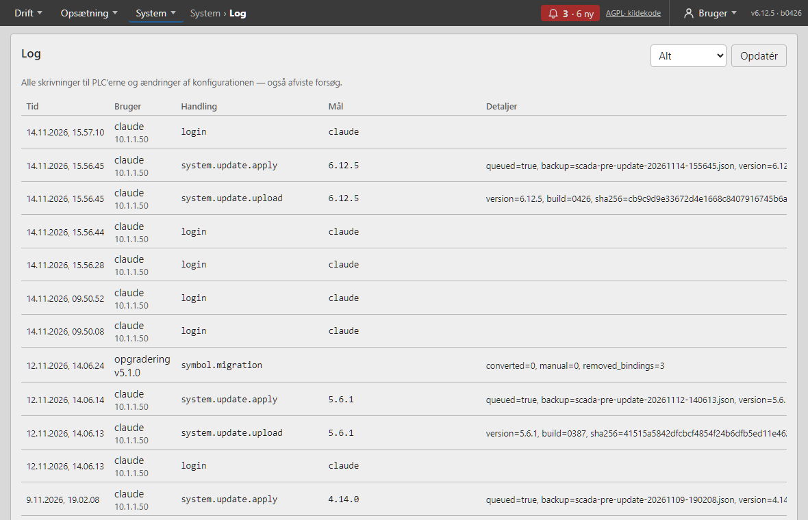
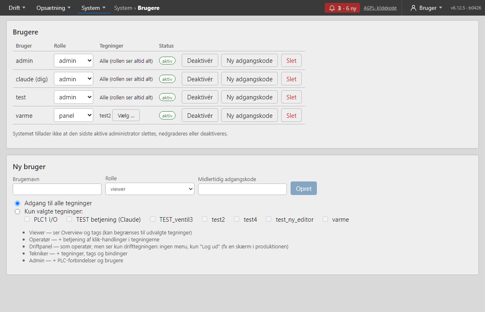
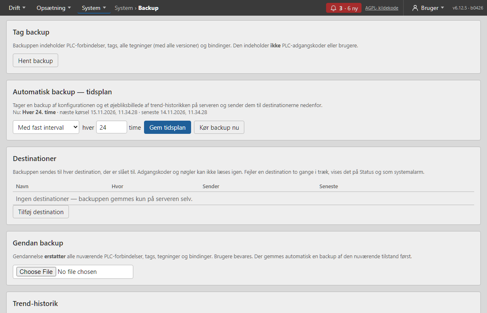
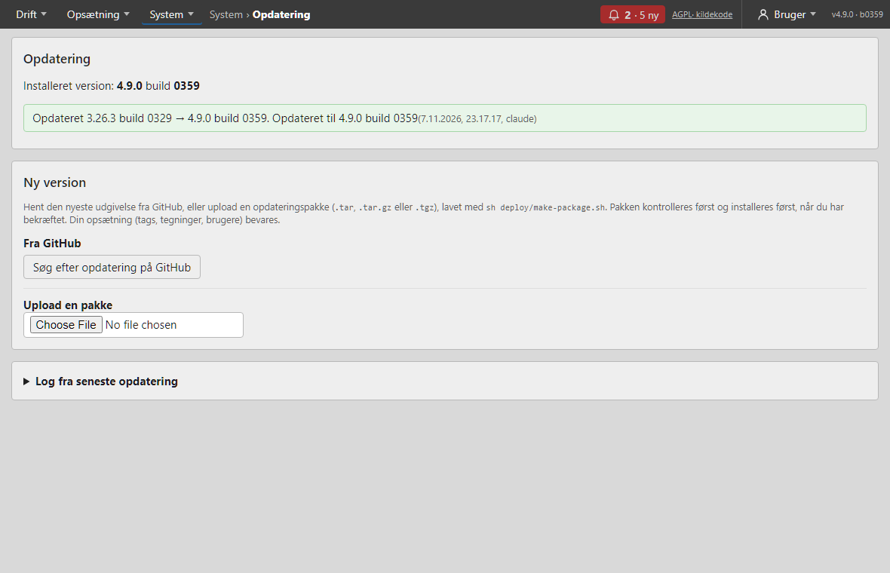
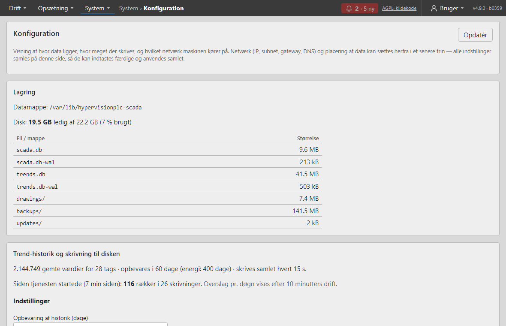
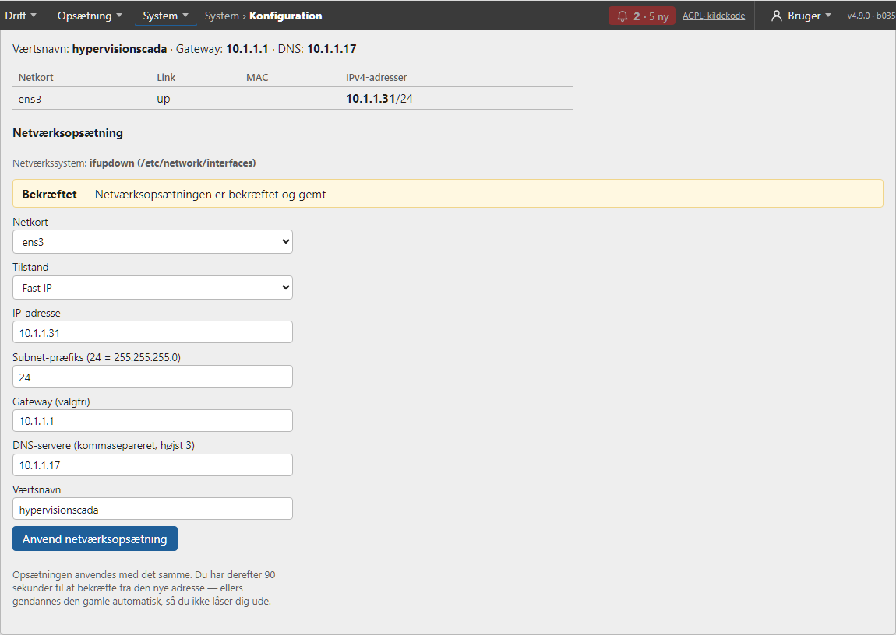

# System

Under **System** ligger Status, Log, Brugere, Backup, Opdatering, Notifikationer, Integrationer, Certifikater og Konfiguration. **Status** og **Log** kræver rollen tekniker; de øvrige kræver **admin**.

## Status

Siden **Status** viser på ét sted, hvordan serveren og PLC'erne har det — og opdaterer sig selv hvert 5. sekund. Øverst står et samlet billede: **Alt i orden** (grøn), **Opmærksomhed** (gul) eller **Fejl** (rød), og under det en liste over det, der er galt, med en forklaring.

- **PLC'er**: forbindelsen pr. PLC (også *delvis fejl*, hvis kun et område eller en ekstern slave svarer dårligt), hvor længe siden PLC'en sidst svarede, hvor mange kald i sekundet SCADA sender (loftet er 5) og hvor mange gange PLC'en har bedt om færre kald (429).
- **Server**: *event-loop-lag* viser, hvor længe serveren sidste minut var optaget uden at kunne svare — normalt få millisekunder; over ¼ sekund giver gul, over 1 sekund rød. Desuden databasens svartid, antal åbne sider (live-forbindelser), alarmer, trend-historikkens størrelse og alderen på seneste backup.
- **Maskine**: ledig disk, hukommelse, CPU-temperatur og — på en Raspberry Pi — om strømforsyningen har været for svag, eller maskinen har sat farten ned pga. varme.

Gul/rød udløses blandt andet af: en PLC der ikke svarer, mindre end 10 % (rød under 5 %) ledig disk, CPU over 75 °C (rød over 85 °C), og en backup der er mere end 1½ gange ældre end intervallet. Siden kun *læser* — den ændrer intet. De samme problemer bliver også til **alarmer** (niveau SYS), så de ikke overses — se kapitlet Alarmer.

### Prometheus og Grafana (`/metrics`)

Samme tal som på siden kan hentes af Prometheus (og vises i Grafana) fra adressen `https://<serverens adresse>/metrics`. Nederst på Status-siden kan en **admin** trykke **Slå til (opret token)**: siden laver et langt, tilfældigt token og viser det *én gang* sammen med et færdigt eksempel til `prometheus.yml`. Serveren gemmer kun en kontrolsum af tokenet, så det kan ikke hentes igen — mistes det, opretter man blot et nyt (det gamle holder så op med at virke). **Slå fra** lukker for `/metrics` igen.

Adgangen sker med headeren `Authorization: Bearer <token>`; en almindelig login-session giver ikke adgang, og tokenet kan ikke sendes i adressen. Der udleveres kun systemtal (fx event-loop-lag, kald i sekundet til hver PLC, om en PLC svarer, alarmantal, disk, hukommelse, temperatur) — aldrig tag-værdier, tag- eller tegningsnavne, brugere eller adgangskoder. Afviste forsøg tælles og logges. Tokenet følger ikke med i en backup og skal sættes igen på en ny server.

### HTTPS-certifikat (Let's Encrypt)

Siden bruger HTTPS. Som standard med et **selvsigneret** certifikat (browsere advarer); et rigtigt **Let's Encrypt-certifikat** sættes op på maskinen med `hypervision-letsencrypt` (certbot + deSEC) — opskriften står i `docs/TLS_LETSENCRYPT.md`. På Status-siden viser kortet *HTTPS-certifikat udløber om* antal dage; **gul under 21 dage og rød under 7** betyder, at den automatiske fornyelse er stoppet og skal ses efter (`hypervision-letsencrypt status`). Det selvsignerede certifikat bliver liggende, hvis udstedelsen fejler, så siden kan altid åbnes.

## Notifikationer

Siden **Notifikationer** (admin) lader SCADA sende besked, når en alarm **rejses** eller **ophører** — som **webhook** (JSON til en adresse; virker med Node-RED, Home Assistant, ntfy, Slack/Teams og andre) og/eller **e-mail** (SMTP).

- **Hvilke alarmer:** som standard kun *høj prioritet* (det kan ændres til medium og højere eller alle). *Send også når alarmen ophører* kan slås fra. Kvittering giver aldrig en besked.
- **Samletid:** alarmer inden for samletiden (standard 20 sekunder) sendes som **én** besked, og en besked viser højst 20 alarmer ("… og N flere"), så en alarmstorm ikke fylder indbakken.
- **E-mail kan sendes på to måder:** via en **SMTP-server** eller via **Resend** (deres HTTPS-API; vælg *Udbyder*). Med Resend indsætter du API-nøglen (`re_…`) og bruger en afsender på et domæne, du har verificeret hos Resend.
- **Hemmeligheder er skriv-kun:** webhook-adressen (den kan indeholde en nøgle), et valgfrit Bearer-token, SMTP-adgangskoden og Resend-nøglen gemmes kun på serveren; siden viser kun, *om* de er sat (og webhook-adressens vært). Skriv en ny værdi for at ændre dem, eller vælg *Fjern*.
- **Send prøvebesked** sender straks en besked med den gemte opsætning og viser den præcise fejl pr. kanal (fx *HTTP 404* eller et afvist login).
- **Fejl:** en mislykket afsendelse prøves igen (efter 5, 30 og 120 sekunder). Mislykkes flere afsendelser i træk, vises det her, på Status-siden og som en **SYS-alarm**. Tabellen *Status* viser de seneste 50 afsendelser; tællere findes også i `/metrics`. Beskeder, der venter på at blive sendt, ligger i hukommelsen og går tabt, hvis tjenesten genstarter. Adressen kan pege på en maskine på det lokale net (fx Node-RED); kun en admin kan sætte den, og med SMTP-login kræves STARTTLS eller SSL.

Webhook-kroppen er `{"type":"alarm","instance":…,"version":…,"time":…,"events":[{"event":"raise"|"clear","key":…,"tag":…,"plc":…,"kind":…,"level":…,"priority":…,"message":…,"time":…}],"more":0}`; et Bearer-token sendes som `Authorization: Bearer <token>`.

## Integrationer

Siden **Integrationer** (admin) giver andre systemer — **Node-RED**, **Home Assistant**, Excel/Power BI, scripts — **læseadgang** til anlægget med en **API-nøgle**, uden at de skal logge ind som en person.

- **En nøgle** oprettes med et navn (hvem bruger den?) og en **afgrænsning**: *alle tags*, eller kun de tags og/eller **præfikser** (alle tags, der starter med fx `kedel_`), du vælger. Tags kan **krydses af** i listen (med søgning), og ofte brugte præfikser foreslås som knapper; feltet *Nøglen ser …* viser hele tiden præcis hvilke tags afgrænsningen giver, hvor mange hvert præfiks rammer, og advarer om ukendte tags og præfikser uden træffere. Valgfrit kan nøglen låses til bestemte **IP-adresser/netværk** (fx `10.1.1.0/24`) og have en **udløbsdato**.
- **Tags eller præfikser?** Et **tag** er et præcist navn: `Akum` giver kun tagget `Akum`, og navnet skal findes. Et **præfiks** giver alle tags, hvis navn *starter med* teksten: `PLC1_` giver `PLC1_DI1`, `PLC1_DI2` osv. — også tags, der oprettes senere. Nøglen ser et tag, hvis det står i tag-listen **eller** matcher et præfiks. Brug **tags** til få, bestemte punkter (fx én temperatur til Home Assistant), så nye tags aldrig kommer med af sig selv; brug **præfikser**, når navnene følger anlægsdele (`fyrrum_`, `PLC1_`), så nøglen følger med, når anlægget udvides. Der skelnes mellem store og små bogstaver (`plc1_` ≠ `PLC1_`), og et kort præfiks kan fange mere, end det andet system skal se. *Alle tags* kun til betroede systemer.
- **Nøglen vises kun én gang** (lige efter oprettelsen, sammen med færdige eksempler). Serveren gemmer kun en kontrolsum og kan ikke give den tilbage — mistes den, tilbagekaldes den og en ny oprettes. Den kan også **deaktiveres** midlertidigt.
- **Hvad en nøgle kan:** kun læse via `/api/v1/integration/…` — punkter, aktuelle værdier, historik og alarmer. Den kan aldrig bruge resten af SCADA (ingen konfiguration, ingen betjening), og en login-session giver heller ikke adgang dér. Der er **ingen styring** (skrivning) i denne version. Værdierne kommer fra SCADA's cache, så integrationer belaster ikke PLC'erne.
- **Hastighedsgrænse:** 20 kald i sekundet pr. nøgle (kortvarigt 40); derefter svares *429* med `Retry-After`. Brug strømmen (nedenfor) til hurtige opdateringer i stedet for at spørge ofte.
- Tabellen viser sidst brugt, fra hvilken IP, antal kald og afviste kald. Oprettelse, ændring og tilbagekaldelse står i auditloggen (aldrig nøglen). Tællere findes i `/metrics`.

**Kald** (alle med headeren `Authorization: Bearer hv_…`):

| Kald | Svar |
|---|---|
| `GET /api/v1/integration/info` | anlæg, version og nøglens afgrænsning og grænser (til at afprøve forbindelsen) |
| `GET /api/v1/integration/points` | de punkter nøglen må se: navn, beskrivelse, enhed, type (`number`/`bool`), område, om der findes historik |
| `GET /api/v1/integration/values?tags=a,b` | `{"time":…, "values": {"a": {"v": 42, "q": "good", "ts": 1760000000.0}}}` — `q` er kvaliteten (`good`, `comm_error`, `bad`, `unknown`) |
| `GET /api/v1/integration/history?tag=a&start=…&end=…&points=600` | nedsamplet historik (`time`, `mean`, `min`, `max`); kræver at historik er slået til for tagget |
| `GET /api/v1/integration/alarms` | aktive og ukvitterede alarmer inden for afgrænsningen |
| `GET /api/v1/integration/stream` | **strøm** (Server-Sent Events): først `snapshot` (alle værdier + aktive alarmer), derefter `values` med kun ændringer (samlet, højst hvert `interval` s, standard 0,5) og `alarm` (`raise`/`clear`/`change`). Valgfrit `tags=…`, `alarms=false`, `max_events=N`. Hjerteslag hvert 15. s; `closed` hvis nøglen deaktiveres/tilbagekaldes; ved genforbindelse sendes et nyt `snapshot`. Højst 5 strømme pr. nøgle. Bag nginx: buffering er slået fra for strømmen |
| `GET /api/v1/integration/openapi.json` | maskinlæsbar beskrivelse (uden nøgle), kan importeres i Postman og andre værktøjer |

**Sådan læses svaret fra `/values`** — eksempel:

```
{"time":"2026-11-04T14:23:00+00:00","values":{"MBX1coil0":{"v":false,"q":"good","ts":1793802180.6}}}
```

| Felt | Betydning |
|---|---|
| `time` | hvornår svaret blev lavet (UTC) |
| `values.<tag>.v` | værdien: tal eller `true`/`false` (en coil/digital = tændt/slukket). `null` = ingen gyldig værdi lige nu |
| `values.<tag>.q` | kvaliteten: `good` = gyldig og frisk; `comm_error` = SCADA har ikke forbindelse til PLC'en; `bad` = PLC'en svarer, men værdien kan ikke bruges (fx svarer en Modbus-slave bag PLC'en ikke, eller variablen findes ikke/er ikke kompileret); `unknown` = endnu ikke læst |
| `values.<tag>.ts` | hvornår værdien sidst blev læst, i Unix-sekunder (UTC) — ikke hvornår svaret blev lavet |

Ved `comm_error` og `bad` er `v` typisk `null`. Når forbindelsen kommer igen, skifter tagget af sig selv tilbage til `good` med en ny værdi — et kort udfald ses altså som et øjeblik med `comm_error`. Brug altid `q` før `v`: en integration bør ignorere eller markere værdier, der ikke er `good`. Sker udfald tit, ses de på **Status** og i **Log**.

**curl:** `curl -k -H "Authorization: Bearer hv_…" https://scada.laces.dk/api/v1/integration/values` (`-k` kun med selvsigneret certifikat).

**Strøm med curl:** `curl -k -N -H "Authorization: Bearer hv_…" https://scada.laces.dk/api/v1/integration/stream`. I Node-RED kan en SSE-node (fx *node-red-contrib-sse-client*) bruges med samme header.

**Node-RED:** brug noden *http request* (GET, returnér et parset JSON-objekt) med headeren `Authorization` = `Bearer hv_…`; kobl den til en *inject*-node med et interval, og læs `msg.payload.values.<tag>.v`. Ved selvsigneret certifikat slås *Verify server certificate* fra i node-ens TLS-opsætning.

**Home Assistant** (`configuration.yaml`):

```yaml
sensor:
  - platform: rest
    name: Kedeltemperatur
    resource: https://scada.laces.dk/api/v1/integration/values?tags=kedel_temp
    headers:
      Authorization: Bearer hv_…
    value_template: "{{ value_json.values.kedel_temp.v }}"
    unit_of_measurement: "°C"
    scan_interval: 30
```

Siden bruger Home Assistant REST-sensorer; en automatisk opdagelse (MQTT) kommer i en senere version.

## Log



**Log** er systemets revisionsspor: **alle skrivninger til PLC'erne og alle ændringer af konfigurationen** — også afviste forsøg. Hver linje viser tidspunkt, bruger, handling, hvad den gjaldt og om det lykkedes. Brug filtrene (*Alt*, *Skrivninger*, *Til/fra*, *Pulser* og flere) til at indsnævre, og **Opdatér** for at hente nyt. Loggen kan ikke redigeres.

## Brugere



**Brugere** (admin) styrer, hvem der må hvad.

- **Ny bruger**: **Brugernavn**, **Rolle** og en **Midlertidig adgangskode** (mindst 10 tegn). Brugeren skal vælge sin egen adgangskode ved første login.
- **Ny adgangskode** nulstiller en brugers adgangskode (en ny midlertidig).
- **Deaktivér/aktivér** spærrer eller åbner kontoen uden at slette den.
- **Slet** fjerner brugeren.
- **Tegningsadgang**: for viewer, operatør og driftpanel kan du vælge, hvilke **tegninger** brugeren ser. Så ser brugeren kun de valgte tegninger på Overview, kun de tags der vises i dem (i Trends kun de trends, der er sat op i tegningerne), og kan kun betjene klik-handlinger i dem. Vælges ingen tegninger, ser brugeren ikke noget (systemet advarer). Tekniker og admin ser altid alle tegninger.

> Systemet tillader **ikke**, at den sidste aktive administrator slettes, nedgraderes eller deaktiveres — så ingen kan låse sig ude. Reglerne håndhæves af serveren.

## Backup



**Backup** (admin) beskytter din opsætning.

- **Hent backup** henter en fil med PLC-forbindelser, tags, alle tegninger (med alle versioner), bindinger, symbolopsætninger og ugeprogrammer. Den indeholder **ikke** PLC-adgangskoder, brugere eller koder til nøglelås.
- **Gendan backup**: vælg en backupfil. Systemet viser først, hvad den indeholder (hvem, hvornår, antal tags/tegninger …). Gendannelse **erstatter** den nuværende opsætning efter en bekræftelse; brugere bevares. Der gemmes automatisk en backup af den nuværende tilstand først. PLC'er uden adgangskode skal have den sat igen under **PLC'er**.
- **Automatisk backup — tidsplan**: vælg *med fast interval* (hver N. time), *dagligt* kl. TT:MM, *bestemte ugedage* eller *slået fra*. Hver kørsel gemmer konfigurationen og et øjebliksbillede af trend-historikken på serveren (de seneste 7 og 2 gemmes) og sender dem til destinationerne. **Kør backup nu** starter en kørsel med det samme. Er serveren slukket, når en kørsel skulle have været, tages den 5 minutter efter opstart. Der tages også en backup **før en gendannelse** og **før en opdatering**.
- **Destinationer** (ekstern/netværk): **SFTP** (anbefalet), **SCP**, **FTPS**, **FTP** (ukrypteret), **HTTPS** (PUT til fx WebDAV/Nextcloud), **SMB** (Windows-share/NAS) og **NFS** (NAS/Linux; monteres af Pi'en selv under `/mnt/hv-backup`, kræver pakken `nfs-common`). For hver vælges hvad der sendes (konfiguration og/eller historik), en mappe og *behold de seneste N* (kun SCADA's egne backupfiler ryddes op; HTTPS kan ikke rydde op).
  - Adgangskoder og tokens er **skriv-kun**. Til SFTP/SCP kan der i stedet laves en **SSH-nøgle**: kun den offentlige del vises, og den lægges i `~/.ssh/authorized_keys` på serveren.
  - **Test forbindelse** skriver og sletter en lille testfil. Ved SFTP/SCP vises serverens **værtsnøgle** første gang; sammenlign den med serveren og tryk *Godkend*. Ændrer nøglen sig senere, afvises forbindelsen (beskyttelse mod at nogen udgiver sig for serveren).
  - Filerne skrives som `….part` og omdøbes til sidst, så der aldrig ligger en halv backup. Mislykkes en afsendelse, prøves igen to gange. Fejler en destination **to kørsler i træk**, vises det på **Status** og som **systemalarm** (SYS); målinger findes i `/metrics` (`scada_backup_*`).
- **Trend-historik**: **hent historik** giver et øjebliksbillede af alle gemte kurver, og **flet historik** indlæser en historikfil og sætter den ind (eksisterende værdier bevares).

## Opdatering



**Opdatering** (admin) installerer en ny version af SCADA'en direkte fra websiden — uden SSH.

1. Byg en **opdateringspakke** på udviklingsmaskinen med `sh deploy/make-package.sh`.
2. **Upload** pakken. Serveren kontrollerer den (kun sikre filer, gyldigt versionsnummer, de nødvendige filer) og viser **version**, størrelse og **kontrolsum**.
3. Tryk **Installér og genstart** og bekræft. Der tages en **backup**, programmet installeres, og serveren **genstarter**. Siden følger forløbet gennem genstarten.
4. Svarer den nye version ikke, **rulles der automatisk tilbage** til den forrige, og du får besked.

| Pakken er … | Så … |
| --- | --- |
| **Nyere** | kan installeres |
| **Samme version** | kan geninstalleres, hvis du sætter hak |
| **Ældre** | afvises — databasen kan være opgraderet |

**Kassér pakken** fjerner en klargjort pakke. Under en opdatering kan intet andet ændres. Loggen fra den seneste opdatering ligger nederst på siden. Kontrolsummen beskytter mod beskadigelse, men en administrator kan via en opdatering i praksis køre kode på serveren — kun betroede personer bør være admin.

**Fra GitHub**: tryk **Søg efter opdatering på GitHub**. Er der en nyere version, viser siden den med udgivelsesnoter; **Hent og klargør** henter pakken, kontrollerer kontrolsummen og klargør den, præcis som hvis du havde uploadet den. Serveren skal have adgang til internettet. Funktionen kan slås fra med `SCADA_UPDATE_REPO=` i `/etc/hypervisionplc-scada.env`.

> Første gang installeres serveren på en ny Raspberry Pi (Raspberry Pi OS Lite) med én kommando, der henter den nyeste udgivelse fra GitHub:
> `curl -fsSL https://raw.githubusercontent.com/Jangreenlarsen/HypervisionPLC-SCADA/main/deploy/bootstrap.sh | sudo sh`
> Siden åbnes derefter på `https://<pi-ens-ip>` (godkend advarslen om det selvsignerede certifikat). Til sidst vises adressen og engangsadgangskoden til `admin`. Derefter kan alle nye versioner komme via siden — pakkerne (`scada-*.tar`) ligger under *Releases* på GitHub.

## Certifikater

Siden **Certifikater** (admin) styrer det certifikat, nginx bruger til HTTPS. Et nyt certifikat kontrolleres, før det tages i brug: passer den private nøgle til certifikatet, er det gyldigt nu, og accepterer nginx det? Går noget galt, gendannes det forrige automatisk, så man ikke kan låse sig ude. Private nøgler og adgangskoder sendes kun til serveren; de vises aldrig igen og står aldrig i loggen.

- **Aktuelt certifikat:** type (selvsigneret, Let's Encrypt eller udstedt af en CA), navn, de adresser det gælder for, udsteder, gyldighed og SHA-256-fingeraftryk. Står den adresse, du bruger nu, ikke i certifikatet, vises en advarsel. **Hent certifikat (PEM)** giver det offentlige certifikat (fx til at lægge ind som betroet på pc'er). **Gendan forrige** skifter tilbage til certifikatet før det sidste skift, og **Tilbage til selvsigneret** til det selvsignerede fra installationen.
- **Selvsigneret:** navn (CN), adresser (værtsnavne og IP-adresser — den adresse, du bruger nu, er udfyldt), gyldighed (standard 825 dage) og nøgletype (EC P-256 anbefales; RSA 2048/4096 til ældre klienter). Laves og installeres med det samme. Browsere advarer, indtil certifikatet godkendes eller lægges ind som betroet.
- **CSR til en CA:** udfyld navn, adresser og evt. organisation, afdeling, by, region, land og e-mail, og tryk **Opret CSR**. Den private nøgle laves på serveren og forlader den aldrig. **Hent CSR** og send den til din CA (fx virksomhedens interne CA). Når certifikatet kommer tilbage, indsættes eller vælges det (PEM, gerne med mellemcertifikater), og **Installér** kontrollerer, at det passer til den ventende nøgle. **Annullér CSR** sletter den ventende nøgle.
- **Importér:** **PKCS#12** (.p12/.pfx med adgangskode) eller **PEM** (certifikat + kæde og privat nøgle; adgangskode kun hvis nøglen er krypteret). Kæden sorteres automatisk. Et udløbet eller endnu ikke gyldigt certifikat afvises; en kort restlevetid giver en advarsel. Højst 64 KB pr. fil.

- **Let's Encrypt:** gratis certifikat, som alle browsere stoler på, og som fornyes automatisk (certbot, ca. hver 60. dag; fornyelsen installeres med samme kontrol og gendannelse). Kræver et **offentligt DNS-navn** (fx `scada.laces.dk`, ikke en IP-adresse). Vælg metode:
  - **HTTP-01 (port 80):** navnet skal pege på anlæggets offentlige IP, og port 80 skal være åben/viderestillet til Pi'en udefra. nginx svarer selv på Let's Encrypts kontrol (`/.well-known/acme-challenge/`); alt andet på port 80 sendes videre til HTTPS.
  - **DNS-01 (deSEC):** virker uden åbne porte. Opret en konto hos deSEC, og læg en CNAME `_acme-challenge.<navn>` → `<navn i zonen>.<deSEC-zone>` hos din DNS-udbyder. Udfyld zone, navn og token og tryk **Gem deSEC-opsætning** — tokenet kan kun skrives, aldrig læses igen.

  Er certbot ikke installeret, vises **Installér certbot** først (kræver internet). Udfyld værtsnavn og e-mail (Let's Encrypt skriver hertil, hvis fornyelsen svigter), kør **Test (staging)** — hele forløbet mod Let's Encrypts testserver, intet ændres — og derefter **Udsted og installér**. Siden følger med, mens det kører, og **Vis log** viser certbots output. Lykkes det ikke, er det nuværende certifikat urørt. En fornyelse, der går i stå, ses på **Status**, når certifikatet nærmer sig udløb.

Alle skift står i auditloggen (uden nøgler og adgangskoder), og antallet af handlinger pr. resultat findes i `/metrics` (`scada_tls_operations_total`). Udløbsdatoen overvåges som før på **Status**. Installationen sker af en lille root-hjælper (`hypervisionplc-scada-tls.path`), som installeres af `install.sh` og ved opdatering.

## Konfiguration



**Konfiguration** (admin) viser, hvor data ligger, hvor meget plads de fylder, og hvor meget der skrives til disken.

- **Lagring**: datamappens placering, størrelsen på databaserne og mapperne, og ledig plads på disken.
- **Trend-historik og skrivning**: antal gemte værdier, hvor længe de opbevares, og hvor mange rækker og skrivninger der er sket siden tjenesten startede (med et overslag pr. døgn efter 10 minutters drift). Det er nyttigt, hvis datamappen ligger på et SD-kort.
- **Netværk**: værtsnavn, netkort med link, MAC og IPv4-adresser, gateway og DNS.

Under trend-historikken kan du ændre tre **indstillinger**; de gemmes og gælder **straks**, uden genstart:

| Indstilling | Betydning | Grænser |
| --- | --- | --- |
| **Opbevaring af historik** | Hvor mange dage trend-værdier gemmes; ældre slettes hver time | 1–365 dage |
| **Skriveinterval** | Hvor ofte nye værdier skrives samlet til disken. Længere interval = færre skrivninger (skåner SD-kortet), men ved strømsvigt kan op til så mange sekunder gå tabt | 1–300 s |
| **Opbevaring af energi** | Hvor længe energi-tags gemmes (til måneds- og årsrapporter); må ikke være kortere end historikken | 30–3650 dage |

Forkerte værdier afvises med en besked. Ændringen skrives i auditloggen.

#### Flyt trend-databasen til en anden disk

For at skåne SD-kortet kan historikken ligge på en **USB-SSD**:

1. Monter disken (fx på `/mnt/ssd`) og opret en mappe til SCADA'en **én gang på maskinen**: `sudo install -d -o scada -g scada -m 0750 /mnt/ssd/scada`.
2. Skriv mappen i feltet **Flyt til mappe** og tryk **Flyt databasen**. Kun mapper under `/mnt` eller `/media` på en **anden disk** end den nuværende kan vælges.
3. Historikken kopieres og **kontrolleres** (samme antal værdier), og først derefter tages den nye database i brug — mens SCADA'en kører. Trends står stille et øjeblik. Fejler noget, er den gamle database uændret.
4. Den gamle fil bliver liggende som `trends.db.moved`, til du selv sletter den.

**Tilbage til datamappen** flytter den den anden vej. Mangler disken ved en genstart, starter SCADA'en alligevel — med en tom database i datamappen og en advarsel på siden; historikken på disken er urørt og kommer tilbage, når disken er monteret og du flytter databasen dertil igen.

### Netværksopsætning



Nederst på siden kan du sætte maskinens netværk. Vælg **netkort** og **tilstand**:

| Tilstand | Betydning |
| --- | --- |
| **DHCP** | Adressen kommer fra routeren (kan ændre sig) |
| **Fast IP** | Du angiver **IP-adresse**, **subnet** (præfiks, fx 24 = 255.255.255.0), evt. **gateway**, **DNS** og **værtsnavn** |
| **DHCP + fast IP som sekundær** | Maskinen får en adresse fra routeren **og** altid den faste adresse ved siden af — så kan siden altid nås på den faste adresse |
| **DHCP, fast IP først efter N fejl** | DHCP forsøges hele tiden. Svarer routeren ikke i **N kontroller** (à 30 sekunder, standard 5), tager maskinen den faste **reserve-IP** i brug, og slipper den igen, så snart DHCP svarer. Reserve-IP'en er midlertidig: efter en genstart starter maskinen forfra med ren DHCP |

I tilstandene med DHCP viser siden **DHCP-vagtens** status (*DHCP svarer*, *ingen DHCP-svar — 2 af 5 kontroller*, *kører på reserve-IP*). Er kablet ude, tælles det ikke som en DHCP-fejl.

Alle felter kontrolleres (gyldig adresse, gateway i samme subnet, højst 3 DNS-servere …), og en forkert værdi afvises med en besked, før noget ændres.

**Sådan undgår du at låse dig ude:** Tryk **Anvend**, og bekræft i dialogen. Opsætningen sættes i kraft med det samme, og du har derefter **90 sekunder** til at åbne siden på den **nye adresse** og trykke **Bekræft**. Gør du ikke det — eller trykker du **Fortryd nu** — gendannes den gamle opsætning automatisk. Hele forløbet står i auditloggen.

> **Understøttede netværkssystemer:** *NetworkManager* (Raspberry Pi OS) og *ifupdown* (`/etc/network/interfaces` — Debian/Ubuntu-servere og VM'er, fx på en ESXi-server). Installationen (`sh deploy/install.sh`, som en OTA-opdatering også kører) finder selv ud af hvilket, og siden viser det. Mangler begge, eller er installationen ikke kørt, viser siden en besked, der siger **hvad** der mangler, i stedet for formularen.
>
> **ifupdown:** ændringen prøves uden at røre `/etc/network/interfaces`, og filen skrives først, når du har bekræftet (der laves en sikkerhedskopi `interfaces.hypervision-bak-…`; de 3 nyeste beholdes). Kun netkortets egen `iface`-blok i hovedfilen ændres — står den i `interfaces.d`, afvises ændringen. **DHCP** kræver DHCP-klienten **dhcpcd** (`apt install dhcpcd-base`): den prøver uden ende og giver adresserne en levetid, som DHCP-vagten bruger. Mangler den, er kun *Fast IP* valgbar. Egen DNS i DHCP-tilstandene kan blive overskrevet af DHCP-klienten ved næste fornyelse — brug *Fast IP*, hvis DNS skal ligge fast. DNS skrives i `/etc/resolv.conf`, hvis den er en almindelig fil (er den et symlink, styrer systemet den selv, og den røres ikke).

Flytning af hele datamappen (databasen med tags, tegninger og brugere) understøttes ikke; det er trend-databasen, der fylder og skriver mest.

### Genstart

Nederst på **System › Konfiguration** er sektionen **Genstart** (kun admin):

- **Genstart SCADA-tjenesten**: kun programmet genstartes (fx efter en ændring i opsætningen). Siden er væk i et øjeblik; maskinen og PLC'erne røres ikke.
- **Genstart maskinen**: hele maskinen starter forfra — fx efter et skift til **fast IP-adresse** eller et systemopdatering. Siden er utilgængelig i ca. 1–2 minutter. Har du ændret IP-adressen, skal du åbne den **nye** adresse bagefter.

Du bliver bedt om at bekræfte. Bagefter venter siden på serveren og genindlæser sig selv, når den svarer igen. Tags, tegninger og brugere ligger i databasen og bevares. Bestillingen står i auditloggen.

Genstart fra web kræver, at maskinen er opdateret med en version, der har den (installationen sætter en lille hjælper op, ligesom for netværk). Står der *ikke installeret*, så opdatér under **System › Opdatering** — eller genstart fra kommandolinjen med `sudo systemctl restart hypervisionplc-scada` / `sudo reboot`.

### Fuld disk: `scada-maint`

Er disken ved at blive fuld, kan du rydde op **på maskinen** — også selv om websiden ikke kan åbnes. Kør som root (`su -c '…'` eller `sudo`):

| Kommando | Hvad den gør |
| --- | --- |
| `scada-maint status` | Viser ledig plads og hvad der fylder (databaser, backups, logfiler, systemjournal) |
| `scada-maint logs` | Tømmer SCADA'ens logfiler og begrænser systemjournalen (`--journal-size 100M`) |
| `scada-maint backups --keep 2 [--moved]` | Sletter gamle backups (beholder de 2 nyeste af hver slags) og evt. `trends.db.moved` |
| `scada-maint trends --keep-days 14 [--shrink]` | Sletter trend-værdier ældre end 14 dage (energi-tags beholdes længere). `--shrink` gør filen mindre (kræver plads) |
| `scada-maint history --audit-days 90 --alarm-days 90` | Trimmer auditloggen og alarmhistorikken |
| `scada-maint trends-reset [--archive MAPPE]` | Nødløsning: sletter **hele** trend-historikken (evt. først en komprimeret kopi) |
| `scada-maint emergency` | Går trin for trin gennem ovenstående, fra det mindst til det mest indgribende, og **stopper, så snart der er plads nok** |

**Alle kommandoer er tørkørsel** (viser hvad der ville ske og hvor meget plads det giver), indtil du tilføjer **`--yes`**. Tags, brugere, tegninger, bindinger og opsætning slettes **aldrig** — kun logfiler, gamle backups og historik. Hvert skridt skrives i systemloggen.

> Er disken *helt* fuld, kan databasen ikke skrive selv en sletning. Start da med `scada-maint logs --yes` og `scada-maint backups --keep 1 --yes` (de frigør plads uden at skrive i databasen), eller gå direkte til `trends-reset`.

## Hjælper (LLM)

**Hjælper (LLM)** (kun admin) er en lokal sprogmodel, der kører på selve SCADA-serveren, kun på CPU og uden internet. Den skal hjælpe med at forklare og opsætte anlægget. Siden her styrer hardware, installation, til/fra og afprøvning. Selve hjælperen bruges fra knappen **Hjælper** i topbjælken (se *Drift › Hjælperen*). Hjælperen skriver aldrig til en PLC.

- **Hardware:** siden viser maskinen (kerner, RAM, AVX2) og foreslår en **hardwareprofil**. Profilen afgør, om hjælperen må slås til, hvor mange tråde den får (kerner minus én), og loftet for dens hukommelse. *Raspberry Pi 4* og *Lille VM/PC* (under 8 GB RAM) har ingen hjælper. Vælg profil og tryk **Gem profil**. Profilen kan også sættes ved installationen med `install.sh --hw vm-16`.
- **Vælg model:** vælg en variant, og tryk **Hent og installér**. Varianterne er:
  - *Hurtig* (Qwen3.5-2B, 1,3 GB): ca. dobbelt så hurtig, lidt svagere på dansk;
  - *Standard* (Qwen3.5-4B, 2,7 GB): anbefalet;
  - *Stor* (Ministral-3-8B, 5,2 GB): bedst på dansk, men ca. halvt så hurtig, og kræver mindst 16 GB RAM.

  Serveren henter pakken fra projektets udgivelser på GitHub og kontrollerer den (SHA256) her og igen før installationen. Fremdriften vises, og **Afbryd** stopper hentningen. Varianter, der ikke passer til hardwareprofilen, kan ikke vælges. En ny variant erstatter den installerede. Serveren skal kunne nå github.com. Kontrolsummen beskytter mod fejl under hentningen, men ikke mod en kompromitteret GitHub-konto (samme niveau som opdatering fra GitHub).
- **LLM-pakke (lukket net):** uden internet installeres hjælperen fra **én samlet fil**, `scada-llm-<arkitektur>-<model>-<build>.tar` (ca. 3–6 GB), med llama.cpp og modellen. Tryk **Vælg LLM-pakke …**. Filen kontrolleres (indhold, arkitektur, licenser) og vises som *Klar til installation*. **Installér og slå til** installerer den. Kontrollen af SHA256 og udpakningen tager nogle minutter.
- **Slå til / Slå fra:** slået fra bruger hjælperen hverken CPU eller RAM. Brug det på maskiner med få ressourcer. **Fjern** sletter modellen fra maskinen.
- **Afprøv:** stiller et kort spørgsmål og viser svartid og hastighed (tokens/s) på netop denne maskine.
- **Hensyn til SCADA'en:** hjælperen kører som sin egen tjeneste med lav prioritet og et fast hukommelsesloft. Live-data, alarmer og betjening går altid først, og kun ét spørgsmål behandles ad gangen.

*Status* viser antal spørgsmål, kald, fejl og seneste svartid, og */metrics* har `scada_assist_*`. Hver bruger kan stille højst 30 spørgsmål i timen.

> VM: sæt CPU-typen til *host* (eller en type med AVX2). Ellers bliver modellen flere gange langsommere, og siden viser en advarsel.

## Bruger

Under **Bruger** i topmenuen ser du dit navn og din rolle, kan **Skifte adgangskode**, åbne **Manual** og **Logge ud**. Versionen af programmet står nederst i menuen.
